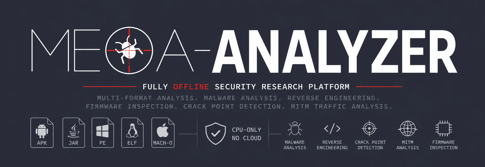
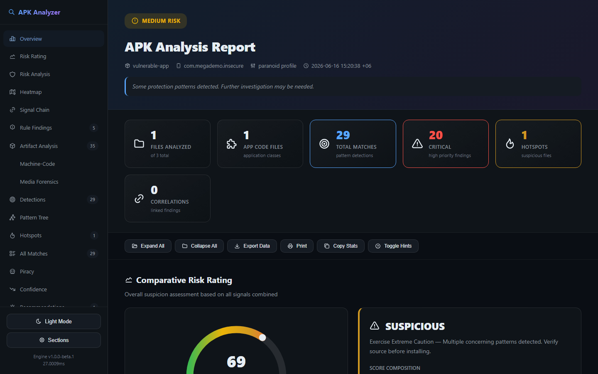
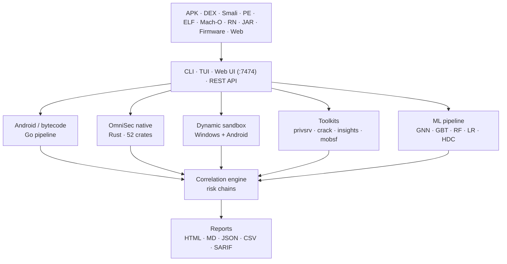

<div align="center">



# Mega-Analyzer

[English](README.md) · [Русский](README.ru.md) · [Quick Start](QUICKSTART.md) · [Build guide](docs/BUILD.md)

[Compare analysis runs](docs/REPORT_COMPARISON.md) · [Prepare a public source snapshot](docs/PUBLIC_SOURCE.md)

</div>

**Local software security analysis with a Go CLI, Web UI and HTML/JSON/SARIF reports.**

The default core scans APK, DEX, Smali, JAR/Minecraft archives and native binary
security properties. Try the included synthetic sample with Go 1.27.3+:

```sh
go build -trimpath -o analyzer ./pkg/cmd/analyzer
./analyzer -t demo/vulnerable-app -report all -sarif
```

On Windows PowerShell use `./analyzer.exe`. Open `analysis_output/REPORT.html`.
[Prebuilt core archives](https://github.com/Promastergame/mega-analyzer/releases)
include the same demo; unpack an archive and run the second command.

APK/DEX decoding is also available as a separate command:
`go build -trimpath -tags noembed -o bin/decompiler ./cmd/decompiler`.
The shared Go API lives in `pkg/decompiler`; see the [decompiler guide (RU)](docs/DECOMPILER.ru.md).

| Capability | Included in core | Additional requirements |
| :--- | :--- | :--- |
| Static analysis, reports, Web UI, REST API | Yes | Static analysis needs no network service |
| OmniSec / Zig / GNN native engines | Optional build | Rust, Zig, C toolchain and the corresponding runtime libraries |
| Android live analysis and instrumentation | Device integration | Configured device/emulator and tools such as ADB/Frida |
| Network scanning and traffic interception | Selected modes | Access to the chosen target and any configured proxy |

No telemetry or cloud upload is required for core analysis. Servers bind to
loopback by default; explicit LAN/container configuration changes that boundary.
Native engines and device analysis have separate build/runtime requirements:
see [build variants](docs/BUILD.md).

mega-analyzer is dual-licensed under [BSD](LICENSE) OR [GPLv2](COPYING).



---

##  Quick start

> [!TIP]
> In a hurry? Skip everything below and run the bundled demo — it produces real findings in seconds with zero setup. Jump to [**See it in action**](#-see-it-in-action).

###  Option A — prebuilt binary

Download the archive for your OS/arch from [**Releases**](https://github.com/Promastergame/mega-analyzer/releases), unpack, and run:

```bash
./analyzer -t my_app.apk -report all
```

###  Option B — build from source

```bash
# Requires Go 1.27.3+ — nothing else
go build -trimpath -ldflags "-s -w" -o analyzer ./pkg/cmd/analyzer
```

> The default build is the **pure-Go core** — a complete, self-contained analyzer. The native engines (OmniSec / Zig / GNN) are optional. See [docs/BUILD.md](docs/BUILD.md).

###  Option C — Docker

```bash
docker build -t mega-analyzer .
docker run --rm -v "$PWD:/work" mega-analyzer -t /work/my_app.apk -report all
```

###  Option D — web UI

```bash
./analyzer -web                 # opens on http://localhost:7474
./analyzer -web -web-port 8080  # custom port
./analyzer -web -admin         # OS-confirmed administrator/root web server
```

Drag a file in, watch the analysis stream live, then explore the report in your browser. See [Web UI & live sandbox](#-web-ui--live-sandbox).

---

##  See it in action

A bundled, intentionally vulnerable sample gives you real findings immediately — no Android SDK, emulator, or real APK required:

```console
$ ./analyzer -t demo/vulnerable-app -report all -sarif

  Mega-Analyzer · target: demo/vulnerable-app
  ─────────────────────────────────────────────
  ▸ manifest audit ........ exported components, debuggable, cleartext, StrandHogg
  ▸ smali scan ............ hardcoded AWS key, Runtime.exec, reflection, weak crypto
  ▸ secret triage ......... AWS · Stripe · Slack · GitHub  (entropy-gated)
  ▸ correlation ........... 6 risk chains linked
  ─────────────────────────────────────────────
  VERDICT: CRITICAL · 29 findings · SARIF: 67 rules
  → analysis_output/REPORT.html
```

Open `analysis_output/REPORT.html` for the interactive report, or feed `analysis_output/analysis.sarif` to any SARIF viewer (VS Code, GitHub, GitLab, SonarQube). See [`demo/`](demo/) for exactly what's planted inside.

---

##  Web UI & live sandbox

Run `analyzer -web` and you get a full **local dashboard** in the browser — drag-and-drop analysis, live progress over Server-Sent Events, and an **ANY.RUN-style live Android device view**. No cloud, no upload: everything stays on `localhost`.

> [!IMPORTANT]
> **Dynamic Sandbox Status:** The dynamic sandbox is an active work-in-progress and is not yet complete.
> Currently, only the **VMware Windows guest environment** (isolated execution, artifact collection, and telemetry) is fully implemented and verified.
> Dynamic analysis and device execution for **Linux** and **Android** are experimental and have not been comprehensively tested yet.

| Feature | What it does |
| :--- | :--- |
| **Drag-and-drop analysis** | Drop an APK/DEX/PE/ELF and watch findings stream in live. Final report, artifact browser, and per-file download all in the page. |
| **Live Android device view** | Real device or emulator mirrored in the browser via **H.264 over WebCodecs** (smooth), with an MJPEG/screenshot fallback. Tap, swipe, long-press, and key input are injected back — drive the app while it's analyzed. |
| **ANY.RUN-style sandbox** | Detonate an APK on a device and watch **processes, network connections, DNS queries, file changes, API calls, and behavioral alerts** appear in real time. Pick the environment (device / emulator / AVD) from a built-in picker. |
| **In-browser Frida REPL** | Push & start `frida-server`, list processes, and run an interactive Frida REPL over WebSocket — or repack the APK with a **Frida Gadget** injected, signed and ready. |
| **Live MITM & traffic capture** | Stream decrypted HTTP(S) requests as they happen (mitmproxy), or capture full PCAP via **PCAPdroid** / on-device tcpdump — DNS, HTTP, and TLS SNI extracted automatically. |
| **Mobile mode** | The whole dashboard is responsive with a dedicated mobile menu — analyze from your phone against a device on the same LAN. |

> [!NOTE]
> The web UI is just another face on the same engine — every tool (decode, machine-code, firmware, diff, JS deobf, sandbox, MITM) is reachable at its own slug (`/sandbox`, `/mitm`, …) and produces the exact same reports as the CLI. The same executable serves the REST API with `analyzer --api` (`/api/v1/*`, with Swagger docs), exposing web-scan and web tooling for automation.

---

##  What it detects

Each finding carries a stable rule-id, severity, confidence, and a context snippet. A false-positive suppression layer (entropy-gated secret triage, library-vs-app-code context, hardening-aware suppression) keeps the signal clean.

| Format | What it surfaces |
| :--- | :--- |
|  **APK / DEX** | Manifest audit (exported components, `debuggable`, cleartext, backup), **task-hijacking / StrandHogg** (custom `taskAffinity`, `singleTask`/`singleInstance`), **grantUriPermissions** leaks, deep links without `assetlinks.json`, `sharedUserId`, dangerous permissions, reflection and native loading in Smali, crack points and patchable methods |
|  **React Native / Hermes** | Full scan of `index.android.bundle` as **application code** (not "noisy framework"): the eval family, `addJavascriptInterface`, prototype pollution, obfuscation; **WebView** leaks (`setAllowUniversalAccessFromFileURLs`, `injectedJavaScript`), **disabled TLS** (`rejectUnauthorized:false`, trust-all), `cordova.exec`; secrets via entropy-gated provider detection |
|  **JAR / Java / WAR** | RCE deserialization (`readObject`, `XMLDecoder`, SnakeYAML, XStream), dynamic code (`URLClassLoader`, ScriptEngine, Groovy), **injection** (JNDI/Log4Shell, SpEL, OGNL, SQL), **XXE** (suppressed when hardening is present), **trust-all TLS** (`X509TrustManager`/`HostnameVerifier`), weak ciphers (ECB/DES/RC4) and hashes, vulnerable dependencies by CVE |
|  **PE (Windows)** | ASLR, DEP/NX, CFG, SafeSEH, stack canaries (`/GS`), AppContainer, digital signature, localized section entropy (packed/encrypted pockets) |
|  **ELF / Mach-O (Linux · Android .so · macOS)** | PIE, NX, **RELRO** (full/partial), stack canaries (SSP), Fortify Source, unsafe `RPATH`/`RUNPATH`, JNI boundaries |
|  **Firmware / IoT** | rootfs hints, telnet/ssh/ftp/upnp services, web panels, hardcoded key/password markers |
|  **Secrets (any text)** | ~25 provider rules (AWS, GitHub, GitLab, Stripe, Slack, Telegram, Discord, OpenAI/Anthropic, Google, private keys, JWT…) with **entropy and charset triage** — real keys pass at full strength; placeholder/low-entropy matches are demoted, not allowed to drown the report |

> [!IMPORTANT]
> **On false positives:** findings are **never silently dropped** — low-confidence ones are demoted in priority. Context (library or app code, parser already hardened, key looks like a placeholder) changes severity, but never hides the signal.

---

##  How it compares

Mega-Analyzer combines a standalone Go core with optional native and device analysis. The comparison below refers to the available capabilities across those build variants; it is not a list of features bundled in every release archive.

| | **Mega-Analyzer** | MobSF | JADX | Ghidra | ANY.RUN | VirusTotal |
| :--- | :---: | :---: | :---: | :---: | :---: | :---: |
| 100% offline / local | ✅ | ⚠️ self-host | ✅ | ✅ | ❌ cloud | ❌ cloud |
| Single binary, no JDK/SDK | ✅ | ❌ | ⚠️ JRE | ⚠️ JRE | n/a | n/a |
| APK / DEX static audit | ✅ | ✅ |  decompile | ➖ | ➖ | ➖ |
| Native PE / ELF / Mach-O | ✅ | ➖ | ➖ | 🥇 deep RE | ➖ | ➖ |
| Dynamic sandbox | ✅ Win + Android | ⚠️ VM addon | ➖ | ➖ | ⚠️ cloud; limited free tier | ⚠️ |
| Live device view + input | ✅ | ➖ | ➖ | ➖ | ✅ | ➖ |
| Decrypted traffic / MITM | ✅ | ⚠️ | ➖ | ➖ | ✅ | ➖ |
| Offline ML scoring | ✅ | ➖ | ➖ | ➖ | ➖ | ⚠️ |
| SARIF / code scanning | ✅ | ➖ | ➖ | ➖ | ➖ | ➖ |
| Binary size | ~60 MB | ~500 MB+ | ~120 MB | ~1 GB+ | n/a (cloud) | n/a (cloud) |
| License | BSD-3-Clause OR GPLv2 | GPL v3 | Apache 2.0 | Apache 2.0 | proprietary | proprietary |
| Price | free | free | free | free | freemium | freemium |

> Where the others win: **Ghidra** is the gold standard for deep native reverse engineering; **MobSF** has a mature ecosystem and integrations. Mega-Analyzer works as an offline, single-binary first pass alongside these tools. Full breakdown: [**docs/COMPARISON.md**](docs/COMPARISON.md).

> **ANY.RUN access and privacy** (reported free-tier experience, October 2026): hosted VMs save you from setting up your own VM. The service is **freemium**, but registration requires a business email on your own domain; acquiring and maintaining that domain and mailbox can cost money even with a free service plan. Reported free-tier limits are **5 minutes per run** and **5 uses of ML features**. Analyses are **public**, including the video recording of your session; **private analysis requires a paid subscription**. These restrictions make the free tier a poor fit for confidential samples or longer interactive investigations.

---

##  Under the hood

### OmniSec engine (Rust core)

The native side is a **52-crate Rust workspace** doing the heavy lifting on machine code:

- **HDC auto-naming (Hyperdimensional Computing)** — recovers meaningful variable/function names locally with **2048-bit sparse hypervectors**. <10 MB RAM, microseconds, no neural nets, no cloud.
- **OmniIR / CFG / SSA / dataflow** — a unified IR with dominators, loops, SSA construction, and inter-procedural dataflow across PDG/IPDG.
- **Deobfuscation pipeline** — constant propagation, dead-code elimination, opaque-predicate removal, variable recovery, loop reconstruction.
- **Symbolic & concolic execution** — untangles obfuscated logic and proves path reachability (DPLL/SMT) to cut false positives.
- **Micro-emulators (x86 / ARM64)** — run code in isolated memory with page permissions to auto-unpack XOR/RC4 strings and hidden payloads.
- **Hyperion v3 — virtualization detection & devirt** — spots VM-dispatcher patterns and lifts handler semantics back to readable code.
- **Behavioral telemetry (eBPF retired)** — the `aya`-based syscall tracer was removed: `omnisec-ebpf` keeps only the serialized-API shim, Linux reads real `/proc` telemetry instead, other platforms use the simulator.
- **GDB-like debugger with replay** — disassembly, breakpoints/watchpoints, patch-and-continue, YARA-like memory scanning, and **time-travel debugging** (`reverse_step`/`reverse_continue`) with incremental snapshots.
- **NCER — network correlation engine** — parses captured traffic (`ncer-parse-net`), reconciles evidence (`ncer-evidence`, `ncer-reconcile`), and surfaces results into Go via FFI (`ncer-reconcile-ffi`, `ncer-types`).
- **Cross-modal graph GNN (`omnisec-ml-graph`)** — a second graph-neural-network path for vulnerability detection that fuses code- and metadata-level features, complementing the DEX license/piracy classifier in `omnisec-ml-gnn`.

<details>
<summary><b>▸ All 52 OmniSec crates</b></summary>

```
omnisec-analysis-symbolic   omnisec-analysis-virt       omnisec-arm64-decode
omnisec-arsc                omnisec-callgraph           omnisec-capture
omnisec-cfg                 omnisec-cli                 omnisec-collections
omnisec-core                omnisec-crypto              omnisec-dataflow
omnisec-debugger            omnisec-debugger-ffi        omnisec-deobfuscator
omnisec-disasm              omnisec-disasm-arm64        omnisec-ebpf
omnisec-emu-arm64           omnisec-emu-x86             omnisec-forge
omnisec-graph               omnisec-hdc                 omnisec-intel-pt
omnisec-ipdg                omnisec-ir                  omnisec-json
omnisec-json-derive         omnisec-lifter-dalvik       omnisec-loader
omnisec-loader-dex          omnisec-loader-elf          omnisec-loader-macho
omnisec-loader-pe           omnisec-log                 omnisec-metrics
omnisec-micro-emu           omnisec-mitm                omnisec-ml-gnn
omnisec-ml-graph            omnisec-ml-inference        omnisec-ncer-evidence
omnisec-ncer-parse-net      omnisec-ncer-reconcile      omnisec-ncer-reconcile-ffi
omnisec-ncer-types          omnisec-net-obfs            omnisec-pdg
omnisec-scan-native         omnisec-smt                 omnisec-ssa
omnisec-z3-worker
```

</details>

### Performance & scale

- **Content-addressed cache** keyed by method SHA-256 — repeat scans up to **10× faster** (CFG/SSA/taint/metrics reused).
- **SIMD ULEB128 batch decoder** (Plan 9 assembly) for the DEX parser hot path — **+30%** throughput (400 vs 310 MB/s on an i5-3340), with a portable fallback.
- **Adaptive worker scheduler** scales the pool by live CPU/heap/GC pressure instead of a static `NumCPU×2`, so huge APKs don't OOM.

---

##  The toolkits

Beyond static detection, Mega-Analyzer ships a set of focused, offline sidecar toolkits — each writes its own Markdown + JSON into the output directory and never blocks the main pipeline.

|  Toolkit | What it gives you |
| :--- | :--- |
| **Dynamic sandbox** | Detonate on **Windows** (Job Objects, optional kernel/syscall monitor, WFP network rules, file/registry/API/network evidence) or **Android** (real device/emulator over ADB, install + launch, live process/network/file capture, traffic capture, downloaded-file pull). |
| **Private Server Toolkit** | Built-in MITM proxy & protocol dissector (Protobuf/MsgPack/JSON), smart client patcher (IP/domain rewrite in APK and `.so`, SSL-pinning bypass), Go server-stub generator from a captured session, an Elixir/OTP **private-server generator** that emits a *runnable* backend — hot-reloadable rule engine, fault-injection scenarios and a live dashboard, with a hand-written reference and a playable demo in [`elixir_privserver/`](elixir_privserver/) — and a Lab DNS server (sinkhole + DGA detection). |
| **Crack Point Discovery** | Finds gate checks (`isPremium`, `checkLicense`, `isRooted`, `isDebuggable`), ranks them by impact, and proposes Smali patches — with a **CFG-aware apply** that rewrites the right basic block, not a blind line swap. |
| **ML Patch Predictor** | **150+ patch patterns** (license, billing v5–v7, premium, ads, root, SSL pinning, Play Integrity, JWT, anti-cheat) ranked by `Risk × Impact / (Cost × Detection × Breakage)`, cross-language (Kotlin · React Native · Flutter · Unity), with SHA-256-verified `.original` backups. |
| **Smart Patcher engine** | Signature-aware patch identity with overload-safe, deterministic patch IDs, a **schema v2** JSON bridge, and a **12-strategy** Smali/JS rewriter — `early_return_true`/`false`, `assign_true`/`false`, `condition_true`/`false`, `inline_true`/`false`, `nop`, `replace_url`, `remove_pin`, `informational` — ranked and normalized by Dalvik return type. Applies **minimal validated blocks** (not blind whole-method swaps): path-safe, idempotent, atomic, with precise **per-patch revert** instead of whole-file rollback. |
| **TOP-5 Insights** | JNI Boundary Analyzer, Privacy Analyzer, Version Diff, Interactive Graph Explorer (HTML), and Firmware/IoT Analyzer. |
| **MobSF-style analyzers, built from scratch** | SAST rule scanner (**105 rules**, CVSS/CWE/OWASP/MASVS), Exodus trackers (**431 signatures**), Network Security Config auditor, deep manifest audit, APKiD packer/obfuscator fingerprinting (**30 signatures**). |
| **Website Analysis + Vulnerability Scanner** | Integrated in the single `analyzer` binary: `status` (one GET/HTTP 200), `passive` (one response, no fuzzing), and authorized `active` mode with curl/raw-HTTP (Burp) import, security headers, CORS, open redirect, JWT, IDOR, SSRF, XSS, SQLi, prototype pollution, GraphQL, and more. Active mode requires explicit `--i-own-this-target`. |
| **Web scanner + vuln scanner** | Full rewrite with pipeline engine, differential analysis, AIMD rate controller; time-based SQLi (CWE-89), OS command injection (CWE-78), +11 new checks. Requires `--i-own-this-target`. |
| **Supply chain audit** | Static SDK profiler in Smali (Firebase, Facebook, Yandex Metrica, Adjust — risk scoring); CVE-2025-55182 React Server Components RCE detection; GitHub Actions/GitLab CI/Jenkinsfile audit (context injection, PPE, mutable action pin); Kubernetes/Docker/AWS IAM config audit (container escape, IAM PassRole, confused-deputy AssumeRole). All offline. |
| **Bytecode + native analysis** | Clear `--scan-bytecode` / `--scan-native` flags. DEX now goes through a full **Hyperion IR** pipeline (MIR → CFG → SSA → DFG via `omnisec-lifter-dalvik`) before scanning — no raw Smali. |
| **Media Forensics** | Polyglot/steganography detection, Exif/GPS metadata analysis, and auto-generated extraction scripts. Full rewrite: 14 new modules. |

<details>
<summary><b>▸ Medium-priority sidecar analyzers (7 more)</b></summary>

Seven additional offline modules write to `<output>/medium/`: Play Store metadata, SBOM extraction, Permission-to-Code mapping, Certificate deep analysis (v1/v2/v3 signing, debug-key), Malware-domain checks, Icon analysis, and NIAP compliance.

</details>

---

##  Private server engine & Bit Arena demo

When the Private Server Toolkit captures a session it can emit a **runnable** Elixir/OTP backend rather than a stub you have to finish. The hand-written reference lives in [`elixir_privserver/mock_server`](elixir_privserver/mock_server) and is the exact shape the generator targets.

|  Part | What it does |
| :--- | :--- |
| **Rule engine** | Declarative `request → response` rules in `priv/rules.json` (regex `path` / `path_prefix` / `method`, first match wins), **hot-reloaded at runtime** so connected clients stay connected. Placeholders like `$premium_token`, `$now` and `$rand_hex` are minted per request. |
| **Fault scenarios** | Live-switchable profiles — `normal`, `flaky` (20–250 ms latency + ~20% `503`s), `offline`, `expired` — flipped mid-session to watch how a client copes when its backend stops being polite. |
| **Live dashboard** | One self-contained HTML page on a separate admin port (no CDN, no external fonts — offline like everything else): request counters, a rolling traffic log, scenario switch and rule reload. |
| **Heuristic fallback** | If no rule matches, the engine recognises auth / license / feature-flag endpoints by name and answers plausibly — an unknown app usually works with zero configuration. |

**Bit Arena** ([`elixir_privserver/demo_game`](elixir_privserver/demo_game)) is a small authoritative multiplayer game server that makes the toolkit tangible: one process per player, one supervised temporary `GenServer` per match, a 20 Hz authoritative tick, an ETS leaderboard, a zero-build browser client and a zero-dependency Node bot. Its only trust boundary is an **unsigned** entitlement token it fetches from its own `/api/v1/session`, so pointing just that lookup at the mock server hands the same account a golden skin, double coins and a speed boost — live on the dashboard:

```bash
# honest game on :4000, private server on :9340
cd elixir_privserver/demo_game/client
node bot.mjs --account guest                                   # tier=free
node bot.mjs --account guest --backend http://localhost:9340   # tier=premium
```

The lesson in one line: *an entitlement your client asks a server for is only as trustworthy as the signature on the answer.* Both apps ship with tests — including one that deliberately proves a forged token is accepted, so it fails the day you add a signature. Full guides: [`elixir_privserver/mock_server/README.md`](elixir_privserver/mock_server/README.md) and [`elixir_privserver/demo_game/README.md`](elixir_privserver/demo_game/README.md).

---

##  Reports & output

One run can emit everything below. Pick a depth with `-profile {quick|balanced|deep|paranoid}` and a verbosity with `-report {short|default|full|all}`.

```text
analysis_output/
├── REPORT.html                 # interactive report (open this first)
├── REPORT.md                   # Markdown for issues / wikis
├── analysis.json               # machine-readable findings
├── analysis.sarif              # optional: -sarif  → GitHub/GitLab code scanning
├── PATCHES.md                  # proposed patches
├── PATCHES_WITH_FIX.md         # patches with applied fixes
├── correlation_report.{md,json}# findings linked into risk chains
├── insights/                   # JNI_BRIDGE · PRIVACY · VERSION_DIFF · GRAPH_EXPLORER · FIRMWARE
├── mobsf/                       # SAST_RULES · EXODUS_TRACKERS · NSC_AUDIT · MANIFEST_AUDIT · APKID
└── medium/                      # SBOM · PERMISSION_MAP · CERT_AUDIT · MALWARE_DOMAINS · ICON · NIAP · PLAYSTORE
```

| Format | Use it for |
| :--- | :--- |
| **HTML** | Reading with your eyes — risk scoring, finding breakdown, artifact browser, crack-point view |
| **Markdown** | Pasting into issues, PRs, and wikis |
| **JSON / CSV** | Scripting and dashboards |
| **SARIF** | GitHub/GitLab code scanning, VS Code SARIF Viewer, SonarQube |

A full flag reference lives in [**docs/USAGE.md**](docs/USAGE.md) and `FlagiFiles.md`.

---

##  Architecture



| Layer | Language | Where |
| :--- | :--- | :--- |
| CLI / TUI / Web UI / REST API | Go | `pkg/cmd/analyzer`, `pkg/api` |
| Static pipeline · taint · SMT · SSA IR | Go | `pkg/internal/{pipeline,taint,smt,ssair}` |
| Dynamic sandbox (Windows + Android) | Go + Zig | `pkg/internal/sandbox`, `zig/sandbox` |
| OmniSec native engine (52 crates) | Rust | `rust/crates/omnisec-*` |
| SIMD ML runtime (XNOR-GEMM · Hamming · SpMV) | Zig | `zig/src` |
| APK Editor IDE — desktop + on-device Android port | Zig + Java | `apk-editor` (separate repository) |
| Distributed analysis server (optional) | Elixir/OTP | `server/` |
| Private-server engine + Bit Arena demo | Elixir/OTP | `elixir_privserver/` |

More detail: [docs/ARCHITECTURE.md](docs/ARCHITECTURE.md).

---

##  Machine learning

ML assists the audit — deliberately lightweight, CPU-only, and fully offline (no LLMs, no gigabyte model weights):

-  **HDC auto-naming** — recovers obfuscated variable/function names locally using sparse associative memory.
-  **Smart risk scoring** — an ensemble (GNN, GBT, Random Forest, Logistic Regression) for spotting dangerous patterns, with **Platt-calibrated confidence** and SHAP-inspired feature attribution.
-  **ML Patcher** — 150+ patch patterns ranked by `Risk × Impact / (Cost × Detection × Breakage)`, with CFG-aware apply and SHA-256-verified backups.

The longer-term plan (conformal prediction, on-device incremental learning, drift monitoring) lives in [docs/ML_ROADMAP.md](docs/ML_ROADMAP.md).

---

##  GitHub code scanning

Mega-Analyzer emits **SARIF**, so its findings appear directly in your repo's **Security → Code scanning** tab and inline on pull requests. Drop in the reusable action:

```yaml
# After building/installing analyzer in the workflow:
- run: ./analyzer -t app-release.apk -report all -sarif -no-profile

- uses: github/codeql-action/upload-sarif@1190a975f95ce23525efb6a3fc21ea29567c1b52 # v3
  with:
    sarif_file: analysis_output/analysis.sarif
```

Full guide: [docs/CODE_SCANNING.md](docs/CODE_SCANNING.md).

---

##  Principles

These constraints are non-negotiable and define what the project is:

- **Local core analysis.** Static scans run without cloud services or telemetry. Servers default to loopback. Explicit network/device modes require their configured targets and tools.
- **Lightweight by mandate.** Targets modest hardware (a 2012-era quad-core, 8 GB RAM). Peak RAM within ~1.5–2 GB; normal runs fit in 500–800 MB. No heavy LLMs or gigabyte model weights.
- **Dual-licensed.** mega-analyzer is dual-licensed under [BSD](LICENSE) OR [GPLv2](COPYING).
- **Defensive only.** For security research, auditing, and defense. Not for building or distributing malware.

---

##  Documentation

| | |
| :--- | :--- |
| [QUICKSTART.md](QUICKSTART.md) | The 60-second version |
| [FlagiFiles.md](FlagiFiles.md) | Complete flag reference — every flag, env var, and build command |
| [docs/USAGE.md](docs/USAGE.md) | Flags, profiles, and recipes (cheat sheet) |
| [docs/BUILD.md](docs/BUILD.md) | Core build vs full native, toolchains, testing |
| [docs/ARCHITECTURE.md](docs/ARCHITECTURE.md) | Directory layout, Go/Rust/Zig/Elixir interaction, adaptive scheduler |
| [docs/COMPARISON.md](docs/COMPARISON.md) | Honest comparison vs MobSF / JADX / Ghidra / ANY.RUN / VirusTotal |
| [docs/FAQ.md](docs/FAQ.md) | Common questions, gotchas, and design choices |
| [docs/CODE_SCANNING.md](docs/CODE_SCANNING.md) | SARIF output and GitHub Action integration |
| [docs/DOCKER_DEPLOYMENT.md](docs/DOCKER_DEPLOYMENT.md) | Docker / Compose / Kubernetes deployment |
| [docs/ROADMAP.md](docs/ROADMAP.md) | Project roadmap (sandbox, ML, detection) |
| [docs/ML_ROADMAP.md](docs/ML_ROADMAP.md) | Machine-learning strategy and roadmap |
| [docs/RELEASING.md](docs/RELEASING.md) | Release workflow and signature verification |
| [docs/SECURITY.md](docs/SECURITY.md) | How to report vulnerabilities (private advisory) |
| [docs/CONTRIBUTING.md](docs/CONTRIBUTING.md) | How to report bugs and suggest ideas (no PRs) |
| [docs/CODE_OF_CONDUCT.md](docs/CODE_OF_CONDUCT.md) | Community standards |
| [docs/DONATION.md](docs/DONATION.md) | Support the project |

---

##  Support the project

You can support Mega-Analyzer with a voluntary [donation via DonationAlerts](https://www.donationalerts.com/r/promastergame).

---

##  License

mega-analyzer is dual-licensed under [BSD](LICENSE) OR [GPLv2](COPYING).

---

##  Project status

| | |
| :--- | :--- |
| **Version** | v1.0.0-beta.1 |
| **Maintainer** | [@Promastergame](https://github.com/Promastergame) — designed and written by a single developer, using AI tools |
| **Contributions** | Solo project — pull requests are not accepted. Bug reports and ideas via [Issues](https://github.com/Promastergame/mega-analyzer/issues). Security vulnerabilities: [private advisory](docs/SECURITY.md). |
| **License** | [BSD](LICENSE) OR [GPLv2](COPYING) |
---

<div align="center">

**Mega-Analyzer** · a whole malware lab on `localhost`

<sub>Dual-licensed under BSD or GPLv2 · See <a href="LICENSE">LICENSE</a> and <a href="COPYING">COPYING</a> for details · runs at 100% with the network cable pulled</sub>

</div>

### Administrator web mode and UTF-8

`-admin` is web-only: Windows UAC, Linux sudo or already-rooted Android su. Loopback and a pairing token are mandatory. Open the printed URL in a normal browser; do not run untrusted samples on your main machine. Windows console UTF-8 and BOM-aware UTF-8 profile files are supported. [Details and patch instructions](docs/WEB_ADMIN.ru.md).
