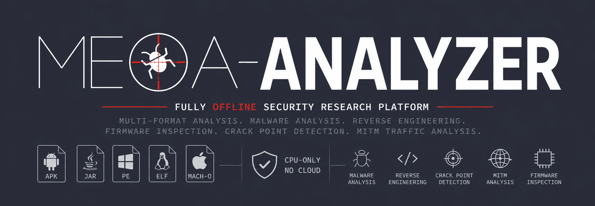
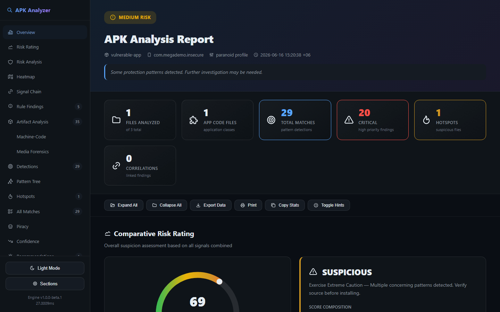
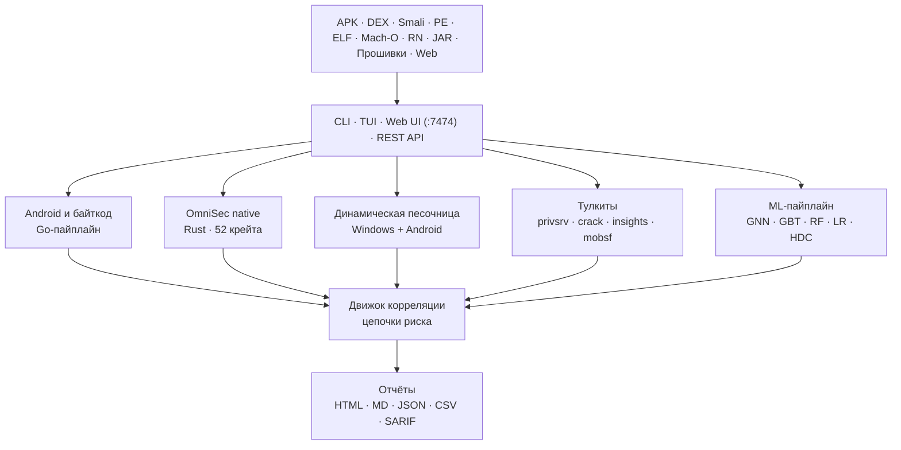

<div align="center">



# Mega-Analyzer

[English](README.md) · [Русский](README.ru.md) · [Быстрый старт](QUICKSTART.md) · [Сборка](docs/BUILD.ru.md)

</div>

**Лаборатория для разбора приложений и бинарников, которая целиком живёт на твоей машине.**
APK, JAR, PE, ELF, прошивки, динамическая песочница, перехват трафика и отчёты в HTML, JSON и SARIF.
Без облака и без телеметрии.

В базовой сборке (core) уже есть анализ APK, DEX, Smali, JAR и Minecraft-архивов, а также проверка
защитных механизмов нативных бинарников. Чтобы запустить учебный пример, нужен Go 1.27.3 или новее:

```sh
go build -trimpath -o analyzer ./pkg/cmd/analyzer
./analyzer -t demo/vulnerable-app -report all -sarif
```

В Windows PowerShell запускай `./analyzer.exe`, а отчёт ищи в `analysis_output/REPORT.html`.
[Готовые core-архивы](https://github.com/Promastergame/mega-analyzer/releases) уже содержат этот пример:
распакуй архив и выполни вторую команду.

Если нужна только декомпиляция, без запуска анализатора, собери отдельную команду:
`go build -trimpath -tags noembed -o bin/decompiler.exe ./cmd/decompiler`.
Подробности и Go API: [docs/DECOMPILER.ru.md](docs/DECOMPILER.ru.md).

Можно подключить локальный DecisionAI: он дополнительно разбирает находки в HTML и JSON, классифицирует
Smali и отвечает на вопросы о результате патча. Как это настроить, написано в
[docs/DECISION_AI.ru.md](docs/DECISION_AI.ru.md).

| Возможность | В core-сборке | Что ещё понадобится |
| :--- | :--- | :--- |
| Статический анализ, отчёты, Web UI, REST API | Есть | Ничего, сеть для статики не нужна |
| Нативные движки OmniSec, Zig и GNN | Отдельная сборка | Rust, Zig, C-тулчейн и нужные библиотеки |
| Живой анализ Android, инструментирование | Через подключённое устройство | Устройство или эмулятор, ADB, Frida и т. п. |
| Сканирование сети, перехват трафика | Отдельные режимы | Доступ к цели и настроенный прокси |

Статическому анализу не нужны ни облако, ни телеметрия. Серверы по умолчанию слушают только loopback.
Если ты сам откроешь доступ из LAN или контейнера, эта граница сдвинется. Что нужно для нативных
движков и анализа на устройстве, описано в [руководстве по сборке](docs/BUILD.ru.md).

mega-analyzer распространяется под двойной лицензией [BSD](LICENSE) ИЛИ [GPLv2](COPYING).



---

##  Быстрый старт

> [!TIP]
> Хочешь сразу увидеть результат? Запусти встроенное демо: оно находит реальные проблемы за несколько секунд,
> и ничего настраивать не надо. Смотри раздел [Демо](#-демо).

###  Вариант A: готовый бинарник

Скачай архив под свою ОС и архитектуру на странице [Releases](https://github.com/Promastergame/mega-analyzer/releases),
распакуй и запусти:

```bash
./analyzer -t my_app.apk -report all
```

###  Вариант B: сборка из исходников

```bash
# Нужен Go 1.27.3+
go build -trimpath -ldflags "-s -w" -o analyzer ./pkg/cmd/analyzer
```

> Сборка по умолчанию написана на чистом Go и работает как полноценный анализатор. Нативные движки
> (OmniSec, Zig, GNN) подключаются по желанию, для них нужны дополнительные тулчейны.
> Подробности в [docs/BUILD.md](docs/BUILD.md).

###  Вариант C: Docker

```bash
docker build -t mega-analyzer .
docker run --rm -v "$PWD:/work" mega-analyzer -t /work/my_app.apk -report all
```

###  Вариант D: Web UI

```bash
./analyzer -web                 # откроется на http://localhost:7474
./analyzer -web -web-port 8080  # свой порт
./analyzer -web -admin          # Web UI с подтверждёнными правами ОС
```

Перетащи файл в окно, смотри, как анализ идёт в реальном времени, а потом изучай отчёт прямо в браузере.
Подробнее: [Web UI и живая песочница](#-web-ui-и-живая-песочница).

---

##  Демо

Во встроенном, намеренно уязвимом примере сразу есть что искать. Android SDK, эмулятор и настоящий APK
для этого не нужны:

```console
$ ./analyzer -t demo/vulnerable-app -report all -sarif

  Mega-Analyzer · цель: demo/vulnerable-app
  ---------------------------------------------
  ▸ аудит манифеста ....... exported-компоненты, debuggable, cleartext, StrandHogg
  ▸ скан smali ............ AWS-ключ в коде, Runtime.exec, рефлексия, слабая крипта
  ▸ триаж секретов ........ AWS · Stripe · Slack · GitHub  (по энтропии)
  ▸ корреляция ............ связано 6 цепочек риска
  ---------------------------------------------
  ВЕРДИКТ: CRITICAL · 29 находок · SARIF: 67 правил
  → analysis_output/REPORT.html
```

Открой `analysis_output/REPORT.html`, там интерактивный отчёт. Файл `analysis_output/analysis.sarif`
можно отдать любому SARIF-вьюверу: VS Code, GitHub, GitLab, SonarQube. Что именно заложено в пример,
описано в [`demo/`](demo/).

---

##  Что умеет Mega-Analyzer

Это не просто сканер манифестов. Внутри целый набор инструментов для разбора приложений и бинарников,
и все они работают локально и выдают отчёты в одном формате.

| Направление | Что внутри |
| :--- | :--- |
| **Мобильная статика** | APK, DEX, Smali, React Native и Hermes. Аудит манифеста, секреты, SAST (105 правил), трекеры Exodus (431 сигнатура), определение пакеров и обфускаторов APKiD (30 сигнатур) |
| **Java и бэкенд** | JAR, WAR, десериализация, инъекции, XXE, слабая криптография, уязвимые зависимости по CVE |
| **Нативные бинарники** | PE, ELF, Mach-O: защитные механизмы, энтропия секций, JNI-границы |
| **Прошивки и IoT** | Подсказки rootfs, сетевые сервисы, веб-панели, захардкоженные ключи и пароли |
| **Реверс и деобфускация** | Rust-движок OmniSec: SSA, dataflow, символьное исполнение, микро-эмуляторы, девиртуализация, отладчик с обратным ходом |
| **Динамическая песочница** | Запуск образцов на Windows (VMware) и Android, процессы, сеть, файлы, вызовы API, извлечение ключей и IV |
| **Трафик и MITM** | Расшифрованный HTTP(S) в реальном времени, PCAP, DNS, TLS SNI |
| **Frida** | Интерактивный REPL в браузере, `frida-server`, сборка APK с Frida Gadget |
| **Патчи и крек-поинты** | Поиск проверок лицензии и root, 150+ патч-паттернов, патчинг с учётом CFG |
| **Приватные серверы** | Диссектор протоколов, патчер клиента, генератор готового Elixir/OTP-сервера |
| **Supply chain** | SDK в Smali, CI-конфиги (GitHub Actions, GitLab CI, Jenkins), K8s, Docker, AWS IAM |
| **Веб-цели** | Vulnscan: time-based SQLi, OS command injection и другие проверки |
| **Медиа-форензика** | Полиглоты, стеганография, Exif и GPS |
| **ML-скоринг** | Лёгкий офлайн-ансамбль, который ранжирует риски и патчи |
| **Отчёты и CI** | HTML, Markdown, JSON, CSV и SARIF для GitHub и GitLab code scanning |

### Что находят проверки по форматам

Каждая находка получает стабильный rule-id, уровень severity, confidence и фрагмент кода вокруг. Чтобы
отчёт не тонул в шуме, работает слой подавления ложных срабатываний: триаж секретов по энтропии,
разделение «библиотека или код приложения» и учёт уже включённой защиты.

| Формат | Что проверяется |
| :--- | :--- |
|  **APK / DEX** | Манифест: экспортируемые компоненты, `debuggable`, cleartext, backup. Task hijacking и StrandHogg (кастомный `taskAffinity`, `singleTask` и `singleInstance`). Утечки через `grantUriPermissions`. Deep-link без `assetlinks.json`. `sharedUserId`, опасные разрешения. Рефлексия и загрузка нативного кода в Smali. Крек-поинты и методы, которые можно пропатчить |
|  **React Native / Hermes** | `index.android.bundle` разбирается как код приложения, а не как шумный фреймворк. Семейство `eval`, `addJavascriptInterface`, прототипное загрязнение, обфускация. Проблемы WebView (`setAllowUniversalAccessFromFileURLs`, `injectedJavaScript`). Отключённая проверка TLS (`rejectUnauthorized:false`, trust-all). `cordova.exec`. Секреты через энтропийный детект по провайдерам |
|  **JAR / Java / WAR** | RCE через десериализацию (`readObject`, `XMLDecoder`, SnakeYAML, XStream). Динамический код (`URLClassLoader`, ScriptEngine, Groovy). Инъекции: JNDI и Log4Shell, SpEL, OGNL, SQL. XXE (находка гасится, если парсер уже защищён). Trust-all TLS (`X509TrustManager`, `HostnameVerifier`). Слабые шифры и хеши (ECB, DES, RC4). Уязвимые зависимости по CVE |
|  **PE (Windows)** | ASLR, DEP/NX, CFG, SafeSEH, стековые канарейки (`/GS`), AppContainer, цифровая подпись. Энтропия по участкам секций помогает находить упакованные и зашифрованные области |
|  **ELF / Mach-O** (Linux, Android `.so`, macOS) | PIE, NX, RELRO (full и partial), стековые канарейки (SSP), Fortify Source, небезопасные `RPATH` и `RUNPATH`, JNI-границы |
|  **Прошивки / IoT** | Подсказки rootfs, сервисы telnet, ssh, ftp и upnp, веб-панели, захардкоженные ключи и пароли |
|  **Секреты в любом тексте** | Около 25 правил по провайдерам: AWS, GitHub, GitLab, Stripe, Slack, Telegram, Discord, OpenAI и Anthropic, Google, приватные ключи, JWT и другие. Энтропийный и charset-триаж: настоящие ключи получают полную severity, а заглушки и совпадения с низкой энтропией понижаются и не заваливают отчёт |
|  **CI, облако, контейнеры** | GitHub Actions, GitLab CI, Jenkinsfile (context injection, PPE, незафиксированные версии). K8s, Docker, AWS IAM (container escape, IAM PassRole, confused deputy). Уязвимость CVE-2025-55182 (RCE в React Server Components) |
|  **Медиа-файлы** | Полиглоты, стеганография, Exif и GPS, автоматически сгенерированные скрипты для извлечения скрытых данных |

> [!IMPORTANT]
> **О ложных срабатываниях.** Находки никогда не пропадают молча. Если уверенность низкая, находка просто
> уходит ниже в приоритете. Контекст (библиотека это или код приложения, защищён ли парсер, похож ли ключ
> на заглушку) меняет severity, но сигнал не прячет.

---

##  Web UI и живая песочница

Команда `analyzer -web` запускает локальную панель в браузере. Анализ идёт прямо там: перетащил файл,
получил прогресс в реальном времени через Server-Sent Events, а рядом есть живой вид Android-устройства
в стиле ANY.RUN. Облака и загрузки на чужие серверы нет, всё остаётся на `localhost`.

> [!IMPORTANT]
> **Статус песочницы.** Динамическая песочница ещё в активной разработке. Полностью реализован и проверен
> пока только режим гостевой Windows в VMware: изолированный запуск и сбор телеметрии внутри виртуальной
> машины. Запуск и анализ на Linux и Android экспериментальные и ещё не прошли комплексное тестирование.

Песочница умеет [извлекать ключи и IV из поддерживаемых криптографических вызовов](docs/SANDBOX_CRYPTO.ru.md)
на Windows и Android. Всё, что удалось получить, смотри на вкладке **Crypto keys** и в отчётах JSON и Markdown.

Для Windows-VM в VMware и Hyper-V есть [сборщик, который хранит отчёты на твоём основном ПК](docs/SANDBOX_VM_HOST.ru.md).
Флаг `-sandbox-remote-config` записывает события и ключи на основную Windows по мере поступления. Отдельный
сервер не нужен, а уже сохранённые данные переживут падение гостевой системы. Этот режим запускается из CLI.
Нативный запуск образца на основной Windows по умолчанию заблокирован.

В веб-интерфейсе можно [запускать Windows-файлы в VMware через Tools](docs/VMWARE-SAFETY.ru.md): подготовить
выключенную ВМ, передать образец, понаблюдать за ним, остановить ВМ и сохранить отчёт на основной
машине. Виртуальные сетевые адаптеры при этом отключены, а учётные данные гостя вводятся на время
конкретного запуска.

| | Возможность | Что делает |
| :---: | :--- | :--- |
|  | **Анализ перетаскиванием** | Брось в окно APK, DEX, PE или ELF и смотри, как находки появляются по ходу работы. Итоговый отчёт, браузер артефактов и скачивание отдельных файлов тоже прямо на странице. |
|  | **Живой вид Android-устройства** | Реальное устройство или эмулятор зеркалируются в браузер через H.264 поверх WebCodecs, а если не выйдет, включится MJPEG или скриншоты. Тапы, свайпы, долгие нажатия и ввод с клавиатуры идут обратно на устройство, так что приложением можно управлять прямо во время анализа. |
|  | **Песочница в стиле ANY.RUN** | Запусти APK на устройстве и смотри в реальном времени процессы, сетевые соединения, DNS-запросы, изменения файлов, вызовы API и поведенческие алерты. Окружение (device, emulator или AVD) выбирается во встроенном пикере. |
|  | **Frida REPL в браузере** | Загрузи и запусти `frida-server`, посмотри список процессов и открой интерактивный Frida REPL по WebSocket. Или пересобери APK со встроенным Frida Gadget: он будет подписан и готов к запуску. |
|  | **Живой MITM и захват трафика** | Смотри расшифрованные HTTP(S)-запросы по мере появления (через mitmproxy) или снимай полный PCAP через PCAPdroid или tcpdump на устройстве. DNS, HTTP и TLS SNI извлекаются автоматически. |
|  | **Мобильный режим** | Вся панель адаптивная, есть отдельное мобильное меню. Можно анализировать с телефона, если устройство в той же локальной сети. |

> [!NOTE]
> Web UI использует тот же движок, что и CLI, поэтому отчёты получаются одинаковые. Каждый инструмент
> (decode, machine-code, firmware, diff, деобфускация JS, sandbox, MITM) открывается по своему адресу,
> например `/sandbox` или `/mitm`. Для автоматизации есть REST API: запусти `analyzer --api`, и методы
> веб-скана и веб-инструментов станут доступны по адресу `/api/v1/*`, а документация Swagger идёт в комплекте.

---

##  Сравнение с другими инструментами

Mega-Analyzer не пытается заменить Ghidra или MobSF. Его идея в другом: один бинарник, который работает
полностью офлайн и сразу закрывает мобильную статику, нативные файлы, динамический анализ, ML и CI.
В таблице видно, что умеет каждый инструмент и где у него границы.

| | **Mega-Analyzer** | MobSF | JADX | Ghidra | ANY.RUN | VirusTotal |
| :--- | :---: | :---: | :---: | :---: | :---: | :---: |
| 100% офлайн, локально | ✅ | ⚠️ self-host | ✅ | ✅ | ❌ облако | ❌ облако |
| Один бинарник, без JDK и SDK | ✅ | ❌ | ⚠️ JRE | ⚠️ JRE | n/a | n/a |
| Статика APK / DEX | ✅ | ✅ | 🔍 декомпиляция | ➖ | ➖ | ➖ |
| Native PE / ELF / Mach-O | ✅ | ➖ | ➖ | 🥇 глубокий RE | ➖ | ➖ |
| Динамическая песочница | ✅ Win + Android | ⚠️ через VM | ➖ | ➖ | ⚠️ ограниченный бесплатный тариф | ⚠️ |
| Живой вид устройства и ввод | ✅ | ➖ | ➖ | ➖ | ✅ | ➖ |
| Расшифрованный трафик, MITM | ✅ | ⚠️ | ➖ | ➖ | ✅ | ➖ |
| Офлайн ML-скоринг | ✅ | ➖ | ➖ | ➖ | ➖ | ⚠️ |
| SARIF, code scanning | ✅ | ➖ | ➖ | ➖ | ➖ | ➖ |
| Лицензия | BSD-3-Clause ИЛИ GPLv2 | GPL v3 | Apache 2.0 | Apache 2.0 | проприетарная | проприетарная |
| Цена | бесплатно | бесплатно | бесплатно | бесплатно | freemium | freemium |

> **Где другие сильнее.** Ghidra остаётся лучшим выбором для глубокого реверса нативного кода, а у MobSF
> зрелая экосистема и много интеграций. Mega-Analyzer удобно запускать первым проходом, а если нужно
> копать глубже, переходить в эти инструменты. Подробный разбор: [docs/COMPARISON.ru.md](docs/COMPARISON.ru.md).

> **Про ANY.RUN: доступ и приватность.** По нашему опыту на октябрь 2026 года, у бесплатного тарифа есть
> нюансы. Облачные VM удобны, потому что свою виртуалку настраивать не нужно. Но для регистрации нужна
> бизнес-почта на собственном домене, а домен и почта могут стоить денег, даже если сам сервис бесплатный.
> Один запуск ограничен 5 минутами, а ML-функциями можно воспользоваться 5 раз. Все анализы публичные,
> включая видеозапись твоих действий в сессии, а приватный режим доступен только по платной подписке.
> Поэтому для конфиденциальных образцов и долгой интерактивной работы бесплатный тариф не подходит.

---

##  Технологии и движки

### Rust-движок OmniSec

Нативная часть проекта это workspace из 52 Rust-крейтов. Именно он делает всю тяжёлую работу с машинным кодом.

| Возможность | Как это работает |
| :--- | :--- |
| **HDC-автонейминг** | Восстанавливает осмысленные имена переменных и функций локально, на 2048-битных разреженных гипервекторах (Hyperdimensional Computing). Нужно меньше 10 МБ ОЗУ, работает за микросекунды, нейросети и облако не используются. |
| **OmniIR, CFG, SSA, dataflow** | Единое промежуточное представление с доминаторами, циклами и построением SSA. Межпроцедурный dataflow идёт через PDG и IPDG. |
| **Деобфускация** | Constant propagation, удаление мёртвого кода, снятие opaque-предикатов, восстановление переменных и циклов. |
| **Символьное и concolic-исполнение** | Распутывает обфусцированную логику и доказывает достижимость путей (DPLL и SMT), поэтому ложных срабатываний становится меньше. |
| **Микро-эмуляторы x86 и ARM64** | Выполняют код в изолированной памяти с правами на страницы и сами распаковывают строки, зашифрованные XOR или RC4, а также спрятанные пейлоады. |
| **Hyperion v3** | Находит паттерны VM-диспетчеров (виртуализацию) и поднимает семантику обработчиков обратно в читаемый код. |
| **Отладчик с replay** | Похож на GDB: дизассемблирование, breakpoint и watchpoint, patch-and-continue, сканирование памяти в духе YARA. Умеет ходить назад во времени (`reverse_step`, `reverse_continue`) на инкрементальных снапшотах. |
| **NCER** | Движок корреляции сетевых данных. Разбирает захваченный трафик (`ncer-parse-net`), сопоставляет доказательства (`ncer-evidence`, `ncer-reconcile`) и передаёт результат в Go через FFI (`ncer-reconcile-ffi`, `ncer-types`). |
| **Графовая GNN** (`omnisec-ml-graph`) | Второй путь поиска уязвимостей на графовой нейросети. Объединяет признаки кода и метаданных и дополняет DEX-классификатор license и piracy из `omnisec-ml-gnn`. |
| **Поведенческая телеметрия** | Трейсер системных вызовов на `aya` удалён, `omnisec-ebpf` остался как API-заглушка. На Linux читается реальная телеметрия из `/proc`, на других платформах работает симулятор. |

<details>
<summary><b>▸ Все 52 крейта OmniSec</b></summary>

```
omnisec-analysis-symbolic   omnisec-analysis-virt       omnisec-arm64-decode
omnisec-arsc                omnisec-callgraph           omnisec-capture
omnisec-cfg                 omnisec-cli                 omnisec-collections
omnisec-core                omnisec-crypto              omnisec-dataflow
omnisec-debugger            omnisec-debugger-ffi        omnisec-deobfuscator
omnisec-disasm              omnisec-disasm-arm64        omnisec-ebpf
omnisec-emu-arm64           omnisec-emu-x86             omnisec-forge
omnisec-graph               omnisec-hdc                 omnisec-intel-pt
omnisec-ipdg                omnisec-ir                  omnisec-json
omnisec-json-derive         omnisec-lifter-dalvik       omnisec-loader
omnisec-loader-dex          omnisec-loader-elf          omnisec-loader-macho
omnisec-loader-pe           omnisec-log                 omnisec-metrics
omnisec-micro-emu           omnisec-mitm                omnisec-ml-gnn
omnisec-ml-graph            omnisec-ml-inference        omnisec-ncer-evidence
omnisec-ncer-parse-net      omnisec-ncer-reconcile      omnisec-ncer-reconcile-ffi
omnisec-ncer-types          omnisec-net-obfs            omnisec-pdg
omnisec-scan-native         omnisec-smt                 omnisec-ssa
omnisec-z3-worker
```

</details>

### Скорость и масштаб

| Что сделано | Результат |
| :--- | :--- |
| **Кеш по SHA-256 метода** | Повторные сканы до 10× быстрее, потому что CFG, SSA, taint и метрики переиспользуются. |
| **SIMD-декодер ULEB128** (ассемблер Plan 9) | Ускоряет горячий путь парсера DEX на 30%: 400 МБ/с против 310 МБ/с на i5-3340. Есть переносимый запасной вариант. |
| **Адаптивный планировщик воркеров** | Размер пула подстраивается под реальную нагрузку на CPU, heap и GC, а не фиксирован на `NumCPU×2`. Огромные APK не приводят к нехватке памяти. |

---

##  Дополнительные тулкиты

Помимо статического анализа, в проект входит набор отдельных офлайн-модулей. Каждый пишет свой Markdown
и JSON в выходную папку и никогда не блокирует основной пайплайн.

|  Тулкит | Что даёт |
| :--- | :--- |
| **Динамическая песочница** | Запуск на **Windows** (Job Objects, необязательный kernel и syscall-монитор, сетевые правила WFP, данные по файлам, реестру, API и сети) или на **Android** (реальное устройство или эмулятор по ADB: установка, запуск, живой захват процессов, сети и файлов, захват трафика, выгрузка скачанных файлов). |
| **Private Server Toolkit** | Встроенный MITM-прокси и диссектор протоколов (Protobuf, MsgPack, JSON). Умный патчер клиента: подмена IP и домена в APK и `.so`, обход SSL pinning. Генератор Go-заглушки сервера из записанной сессии. **Генератор приватного Elixir/OTP-сервера**, который выдаёт готовый к запуску бэкенд с движком правил, горячей перезагрузкой, сценариями сбоев и живым дашбордом (эталонная рукописная версия и играбельное демо лежат в [`elixir_privserver/`](elixir_privserver/)). Плюс Lab DNS: sinkhole и детект DGA. |
| **Crack Point Discovery** | Находит проверки вроде `isPremium`, `checkLicense`, `isRooted`, `isDebuggable`, ранжирует их по влиянию и предлагает Smali-патчи. Патч применяется с учётом CFG: правится нужный базовый блок, а не слепо заменяется строка. |
| **ML Patch Predictor** | Больше 150 патч-паттернов (license, billing v5 to v7, premium, реклама, root, SSL pinning, Play Integrity, JWT, anti-cheat), ранжированных по формуле `Risk × Impact / (Cost × Detection × Breakage)`. Работает для Kotlin, React Native, Flutter и Unity, резервные копии `.original` проверяются по SHA-256. |
| **TOP-5 Insights** | JNI Boundary Analyzer, Privacy Analyzer, Version Diff, Interactive Graph Explorer (HTML) и Firmware/IoT Analyzer. |
| **Аналоги MobSF, написанные с нуля** | Сканер SAST-правил (**105 правил**, CVSS, CWE, OWASP, MASVS), трекеры Exodus (**431 сигнатура**), аудитор Network Security Config, глубокий аудит манифеста, определение пакеров и обфускаторов APKiD (**30 сигнатур**). |
| **Vulnscan** | Полностью переписан: pipeline engine, дифференциальный анализ, AIMD-контроль скорости запросов. Новые проверки: time-based SQLi (CWE-89), OS command injection (CWE-78) и ещё 11 других. Для активного режима нужен флаг `--i-own-this-target`. |
| **Аудит supply chain** | Статическое определение SDK в Smali (Firebase, Facebook, Yandex Metrica, Adjust) с оценкой риска. CVE-2025-55182 (RCE в React Server Components). Аудит GitHub Actions, GitLab CI и Jenkinsfile (context injection, PPE, изменяемые версии). Аудит конфигов K8s, Docker и AWS IAM (container escape, IAM PassRole, confused deputy). Всё работает офлайн. |
| **Анализ байткода и нативных файлов** | Флаги `--scan-bytecode` и `--scan-native`. DEX проходит через пайплайн **Hyperion IR** (MIR, CFG, SSA, DFG через `omnisec-lifter-dalvik`), то есть анализируется OmniIR, а не сырой Smali. |
| **Media Forensics** | Поиск полиглотов и стеганографии, анализ Exif и GPS, автоматическая генерация скриптов для извлечения данных. Полностью переписан, добавлено 14 новых модулей. |

<details>
<summary><b>▸ Ещё 7 дополнительных анализаторов</b></summary>

Эти офлайн-модули пишут результат в `<output>/medium/`: метаданные Play Store, извлечение SBOM, карта
Permission-to-Code, глубокий анализ сертификата (подписи v1, v2, v3, debug-ключ), проверка по списку
вредоносных доменов, анализ иконок и соответствие NIAP.

</details>

---

##  Приватный сервер и демо Bit Arena

Когда Private Server Toolkit записывает сессию, он может выдать готовый к запуску бэкенд на Elixir/OTP,
а не заготовку, которую ещё надо дорабатывать. Эталонная рукописная версия лежит в
[`elixir_privserver/mock_server`](elixir_privserver/mock_server), и генератор целится именно в такую форму.

|  Часть | Что делает |
| :--- | :--- |
| **Движок правил** | Декларативные правила «запрос → ответ» лежат в `priv/rules.json` (regex для `path`, `path_prefix` и `method`, срабатывает первое совпадение). Правила перезагружаются на лету, поэтому подключённые клиенты не отваливаются. Плейсхолдеры `$premium_token`, `$now` и `$rand_hex` подставляются на каждый запрос. |
| **Сценарии сбоев** | Профили переключаются прямо во время сессии: `normal`, `flaky` (задержка 20 до 250 мс и около 20% ответов `503`), `offline`, `expired`. Так видно, как клиент переживает бэкенд, который перестал быть вежливым. |
| **Живой дашборд** | Одна самодостаточная HTML-страница на отдельном admin-порту, без CDN и внешних шрифтов, то есть офлайн, как и всё остальное. Счётчики запросов, лог трафика, переключатель сценариев и перезагрузка правил. |
| **Эвристический fallback** | Если ни одно правило не подошло, движок по названию узнаёт эндпоинты авторизации, лицензии и feature-флагов и отвечает правдоподобно. Незнакомое приложение обычно заводится без всякой настройки. |

**Bit Arena** ([`elixir_privserver/demo_game`](elixir_privserver/demo_game)) это небольшой мультиплеерный сервер
с авторитарной логикой, на котором тулкит показан в деле. На каждого игрока свой процесс, на каждый матч один
supervised временный `GenServer`, авторитарный тик 20 Гц, лидерборд в ETS, браузерный клиент без сборки и
Node-бот без зависимостей. Единственное место, где сервер доверяет клиенту, это **неподписанный** токен
энтайтлмента, который игра получает от собственного `/api/v1/session`. Если направить на mock-сервер только
этот запрос, тот же аккаунт получит золотой скин, двойные монеты и прибавку к скорости, и всё это видно на дашборде:

```bash
# честная игра на :4000, приватный сервер на :9340
cd elixir_privserver/demo_game/client
node bot.mjs --account guest                                   # tier=free
node bot.mjs --account guest --backend http://localhost:9340   # tier=premium
```

Мораль простая: энтайтлмент, за которым клиент ходит на сервер, стоит ровно столько, сколько стоит подпись
на ответе. У обоих приложений есть тесты, и один из них специально доказывает, что подделанный токен
принимается. Поэтому он упадёт в тот день, когда ты добавишь подпись. Полные гайды:
[`elixir_privserver/mock_server/README.md`](elixir_privserver/mock_server/README.md) и
[`elixir_privserver/demo_game/README.md`](elixir_privserver/demo_game/README.md).

---

##  Отчёты и результаты

За один прогон можно получить всё, что перечислено ниже. Глубину анализа задаёт флаг
`-profile {quick|balanced|deep|paranoid}`, а подробность отчёта флаг `-report {short|default|full|all}`.

```text
analysis_output/
├── REPORT.html                 # интерактивный отчёт (открывай первым)
├── REPORT.md                   # Markdown для issues и вики
├── analysis.json               # находки в машиночитаемом виде
├── analysis.sarif              # по флагу -sarif: GitHub и GitLab code scanning
├── PATCHES.md                  # предложенные патчи
├── PATCHES_WITH_FIX.md         # патчи с применённым исправлением
├── correlation_report.{md,json}# находки, связанные в цепочки риска
├── insights/                   # JNI_BRIDGE · PRIVACY · VERSION_DIFF · GRAPH_EXPLORER · FIRMWARE
├── mobsf/                      # SAST_RULES · EXODUS_TRACKERS · NSC_AUDIT · MANIFEST_AUDIT · APKID
└── medium/                     # SBOM · PERMISSION_MAP · CERT_AUDIT · MALWARE_DOMAINS · ICON · NIAP · PLAYSTORE
```

| Формат | Для чего |
| :--- | :--- |
| **HTML** | Читать глазами: оценка рисков, разбивка находок, браузер артефактов, вид крек-поинтов |
| **Markdown** | Вставлять в issues, PR и вики |
| **JSON и CSV** | Скрипты и дашборды |
| **SARIF** | GitHub и GitLab code scanning, VS Code SARIF Viewer, SonarQube |

Полный справочник флагов: [docs/USAGE.ru.md](docs/USAGE.ru.md) и `FlagiFiles.md`.

---

##  Архитектура



| Слой | Язык | Где лежит |
| :--- | :--- | :--- |
| CLI, TUI, Web UI, REST API | Go | `pkg/cmd/analyzer`, `pkg/api` |
| Статический пайплайн, taint, SMT, SSA IR | Go | `pkg/internal/{pipeline,taint,smt,ssair}` |
| Динамическая песочница (Windows и Android) | Go + Zig | `pkg/internal/sandbox`, `zig/sandbox` |
| Нативный движок OmniSec (52 крейта) | Rust | `rust/crates/omnisec-*` |
| SIMD ML-рантайм (XNOR-GEMM, Hamming, SpMV) | Zig | `zig/src` |
| APK Editor IDE (десктоп и порт на Android) | Zig + Java | `apk-editor` (отдельный репозиторий) |
| Сервер распределённого анализа (необязательный) | Elixir/OTP | `server/` |
| Движок приватного сервера и демо Bit Arena | Elixir/OTP | `elixir_privserver/` |

Подробнее: [docs/ARCHITECTURE.ru.md](docs/ARCHITECTURE.ru.md).

---

##  Машинное обучение

ML здесь помогает аудиту и намеренно сделан лёгким: работает на CPU, полностью офлайн, без LLM и без
гигабайтных весов.

-  **HDC-автонейминг.** Локально восстанавливает имена обфусцированных переменных и функций на разреженной ассоциативной памяти.
-  **Скоринг рисков.** Ансамбль из GNN, GBT, Random Forest и Logistic Regression ищет опасные паттерны. Используется калибровка Платта и атрибуция признаков в духе SHAP.
-  **ML Patcher.** Больше 150 патч-паттернов, ранжированных по `Risk × Impact / (Cost × Detection × Breakage)`, с применением по CFG и резервными копиями, проверенными по SHA-256.

Что планируется дальше (конформное прогнозирование, инкрементальное дообучение на устройстве, мониторинг
дрейфа), описано в [docs/ML_ROADMAP.md](docs/ML_ROADMAP.md).

---

##  GitHub code scanning

Mega-Analyzer умеет выдавать **SARIF**, поэтому находки появляются прямо на вкладке **Security → Code scanning**
и в комментариях к pull request. Достаточно добавить анализатор в workflow:

```yaml
# After building/installing analyzer in the workflow:
- run: ./analyzer -t app-release.apk -report all -sarif -no-profile

- uses: github/codeql-action/upload-sarif@1190a975f95ce23525efb6a3fc21ea29567c1b52 # v3
  with:
    sarif_file: analysis_output/analysis.sarif
```

Полное руководство: [docs/CODE_SCANNING.md](docs/CODE_SCANNING.md).

---

##  Принципы

Эти правила не обсуждаются, на них держится весь проект.

| | |
| :---: | :--- |
|  | **Статический анализ только локально.** Никаких облачных сервисов и телеметрии. Серверы по умолчанию слушают loopback, а явные сетевые режимы работают только с теми целями и инструментами, которые ты сам настроил. |
|  | **Лёгкость как требование.** Ориентир: скромное железо, например 4 ядра уровня 2012 года и 8 ГБ ОЗУ. Пик памяти около 1.5 до 2 ГБ, в обычной работе 500 до 800 МБ. Никаких тяжёлых LLM и гигабайтных весов. |
|  | **Только для защиты.** Проект создан для исследований безопасности, аудита и защиты. Он не предназначен для создания и распространения вредоносного ПО. |

---

##  Документация

| | |
| :--- | :--- |
| [QUICKSTART.md](QUICKSTART.md) | Версия на 60 секунд |
| [FlagiFiles.md](FlagiFiles.md) | Полный справочник: все флаги, переменные окружения и команды сборки |
| [docs/USAGE.ru.md](docs/USAGE.ru.md) | Флаги, профили и рецепты (шпаргалка) |
| [docs/BUILD.md](docs/BUILD.md) | Core-сборка и полная нативная, тулчейны, тесты |
| [docs/ARCHITECTURE.ru.md](docs/ARCHITECTURE.ru.md) | Структура каталогов, как взаимодействуют Go, Rust, Zig и Elixir, адаптивный планировщик |
| [docs/COMPARISON.ru.md](docs/COMPARISON.ru.md) | Честное сравнение с MobSF, JADX, Ghidra, ANY.RUN и VirusTotal |
| [docs/FAQ.ru.md](docs/FAQ.ru.md) | Частые вопросы, подводные камни и проектные решения |
| [docs/CODE_SCANNING.md](docs/CODE_SCANNING.md) | SARIF и интеграция с GitHub Action |
| [docs/DOCKER_DEPLOYMENT.md](docs/DOCKER_DEPLOYMENT.md) | Развёртывание через Docker, Compose и Kubernetes |
| [docs/ROADMAP.ru.md](docs/ROADMAP.ru.md) | Планы по песочнице, ML и детектам |
| [docs/ML_ROADMAP.md](docs/ML_ROADMAP.md) | Стратегия и планы по машинному обучению |
| [docs/RELEASING.md](docs/RELEASING.md) | Как выпускаются релизы и проверяется подпись |
| [docs/SECURITY.ru.md](docs/SECURITY.ru.md) | Как сообщить об уязвимости (приватный advisory) |
| [docs/CONTRIBUTING.ru.md](docs/CONTRIBUTING.ru.md) | Как сообщать о багах и предлагать идеи (PR не принимаются) |
| [docs/CODE_OF_CONDUCT.ru.md](docs/CODE_OF_CONDUCT.ru.md) | Правила сообщества |
| [docs/DONATION.ru.md](docs/DONATION.ru.md) | Как поддержать проект |

---

##  Поддержать проект

Если Mega-Analyzer оказался полезным, можно отправить добровольный
[донат через DonationAlerts](https://www.donationalerts.com/r/promastergame).

---

##  Статус проекта

| | |
| :--- | :--- |
| **Версия** | v1.0.0-beta.1 |
| **Автор** | [@Promastergame](https://github.com/Promastergame). Спроектировано и написано одним разработчиком с помощью ИИ |
| **Лицензия** | [BSD](LICENSE) ИЛИ [GPLv2](COPYING) |

---

<div align="center">

**Mega-Analyzer** · целая лаборатория для малвари на `localhost`

<sub>Двойная лицензия BSD или GPLv2 · см. <a href="LICENSE">LICENSE</a> и <a href="COPYING">COPYING</a> · статический анализ работает даже с выдернутым сетевым кабелем</sub>

</div>