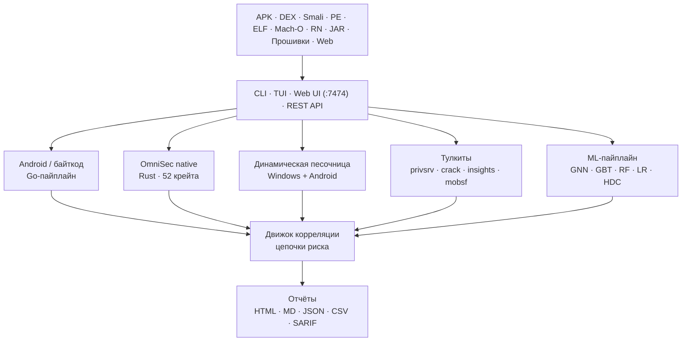

<div align="center">


# Mega-Analyzer

[English](README.md) · [Русский](README.ru.md) · [Быстрый старт](QUICKSTART.md) · [Сборка](docs/BUILD.ru.md)

</div>

**Локальный анализ безопасности ПО: Go CLI, веб-интерфейс и отчёты HTML/JSON/SARIF.**

Базовая core-сборка проверяет APK, DEX, Smali, JAR/Minecraft-архивы и защитные
свойства нативных бинарников. Для запуска учебного примера нужен Go 1.27.3+:

```sh
go build -trimpath -o analyzer ./pkg/cmd/analyzer
./analyzer -t demo/vulnerable-app -report all -sarif
```

В Windows PowerShell используйте `./analyzer.exe`. Откройте `analysis_output/REPORT.html`.
[Готовые core-архивы](https://github.com/Promastergame/mega-analyzer/releases)
содержат тот же пример: распакуйте архив и выполните вторую команду.

Для декомпиляции без запуска анализатора есть отдельная команда:
`go build -trimpath -tags noembed -o bin/decompiler.exe ./cmd/decompiler`.
[Запуск и Go API декомпилятора](docs/DECOMPILER.ru.md).

[Подключение локального DecisionAI](docs/DECISION_AI.ru.md): дополнительный
разбор находок в HTML/JSON, классификация Smali и вопросы о результате патча.

| Возможность | В core-сборке | Дополнительные требования |
| :--- | :--- | :--- |
| Статический анализ, отчёты, Web UI, REST API | Да | Статическому анализу сетевой сервис не нужен |
| Нативные движки OmniSec / Zig / GNN | Отдельный вариант сборки | Rust, Zig, C toolchain и соответствующие библиотеки при запуске |
| Живой анализ Android и инструментирование | Интеграция с устройством | Настроенное устройство/эмулятор и инструменты вроде ADB/Frida |
| Сканирование сети и перехват трафика | Выбранные режимы | Доступ к заданной цели и настроенному прокси |

Для статического анализа не требуются облачная загрузка и телеметрия. Серверы
по умолчанию слушают loopback; явная настройка LAN/контейнера меняет эту границу.
Требования нативных движков и анализа устройств описаны в [руководстве по сборке](docs/BUILD.ru.md).

mega-analyzer распространяется под двойной лицензией [BSD](LICENSE) ИЛИ [GPLv2](COPYING).

**Текущая версия бесплатна. Новые крупные версии будут платными:** уже скачанной
бесплатной версией можно продолжать пользоваться без покупки обновления.
Нужна своя функция, интеграция или утилита? [Закажите доработку у автора](docs/SUPPORT.ru.md#доработки-на-заказ).
[Условия обновлений](docs/SUPPORT.ru.md#версии-и-обновления).


---

##  Быстрый старт

> [!TIP]
> Спешишь? Пропусти всё ниже и запусти встроенное демо — оно выдаёт реальные находки за секунды без какой-либо подготовки. Сразу к разделу [**Демо в деле**](#-демо-в-деле).

###  Вариант A — готовый бинарник

Скачай архив под свою ОС/архитектуру со страницы [**Releases**](https://github.com/Promastergame/mega-analyzer/releases), распакуй и запусти:

```bash
./analyzer -t my_app.apk -report all
```

###  Вариант B — сборка из исходников

```bash
# Нужен только Go 1.27.3+ — больше ничего
go build -trimpath -ldflags "-s -w" -o analyzer ./pkg/cmd/analyzer
```

> Сборка по умолчанию — это **чистое Go-ядро**, полноценный самодостаточный анализатор. Нативные движки (OmniSec / Zig / GNN) опциональны. См. [docs/BUILD.md](docs/BUILD.md).

###  Вариант C — Docker

```bash
docker build -t mega-analyzer .
docker run --rm -v "$PWD:/work" mega-analyzer -t /work/my_app.apk -report all
```

###  Вариант D — Web UI

```bash
./analyzer -web                 # открывается на http://localhost:7474
./analyzer -web -web-port 8080  # свой порт
./analyzer -web -admin         # Web UI с подтверждёнными правами ОС
```

Перетащи файл, смотри как анализ стримится в реальном времени, потом изучай отчёт в браузере. См. [Web UI и живая песочница](#-web-ui-и-живая-песочница).

---

##  Демо в деле

Встроенный, намеренно уязвимый сэмпл сразу выдаёт реальные находки — без Android SDK, эмулятора или настоящего APK:

```console
$ ./analyzer -t demo/vulnerable-app -report all -sarif

  Mega-Analyzer · цель: demo/vulnerable-app
  ─────────────────────────────────────────────
  ▸ аудит манифеста ....... exported-компоненты, debuggable, cleartext, StrandHogg
  ▸ скан smali ............ хардкод AWS-ключа, Runtime.exec, рефлексия, слабая крипта
  ▸ триаж секретов ........ AWS · Stripe · Slack · GitHub  (по энтропии)
  ▸ корреляция ............ связано 6 цепочек риска
  ─────────────────────────────────────────────
  ВЕРДИКТ: CRITICAL · 29 находок · SARIF: 67 правил
  → analysis_output/REPORT.html
```

Открой `analysis_output/REPORT.html` для интерактивного отчёта или скорми `analysis_output/analysis.sarif` любому SARIF-вьюверу (VS Code, GitHub, GitLab, SonarQube). Что именно туда заложено — см. [`demo/`](demo/).

---

##  Web UI и живая песочница

Запусти `analyzer -web` — и получишь полноценную **локальную панель** в браузере: drag-and-drop анализ, прогресс в реальном времени через Server-Sent Events и **живой вид Android-устройства в стиле ANY.RUN**. Без облака и загрузок — всё остаётся на `localhost`.

> [!IMPORTANT]
> **Статус песочницы:** Динамическая песочница находится в стадии активной разработки и ещё не завершена полностью.
> На данный момент полноценно реализован и проверен только режим **гостевой Windows в VMware** (изолированный запуск и сбор телеметрии в виртуальной машине).
> Динамический запуск и анализ для **Linux** и **Android** пока экспериментальные и комплексно не тестировались.

Песочница умеет [извлекать ключи и IV из поддерживаемых криптографических вызовов](docs/SANDBOX_CRYPTO.ru.md)
на Windows и Android. Наблюдаемый материал доступен во вкладке **Crypto keys** и в JSON/Markdown-отчётах.

Для Windows-VM в VMware/Hyper-V есть [сборщик с хранением отчётов на своём ПК](docs/SANDBOX_VM_HOST.ru.md):
`-sandbox-remote-config` сохраняет события и ключи на основной Windows по мере получения.
Дополнительный сервер не нужен; уже записанные данные переживают отказ гостевой Windows.
Этот режим запускается через CLI. Нативный запуск образца на основной Windows по умолчанию заблокирован.

В веб-интерфейсе доступен [запуск Windows-файлов в VMware через Tools](docs/VMWARE-SAFETY.ru.md):
подготовка выключенной ВМ, передача образца, базовое наблюдение, остановка и
сохранение отчёта на основном ПК. Этот режим использует отключённые виртуальные
сетевые адаптеры; гостевые учётные данные вводятся для текущего запуска.

| | Возможность | Что делает |
| :---: | :--- | :--- |
|  | **Drag-and-drop анализ** | Перетащи APK/DEX/PE/ELF и смотри, как находки приходят в реальном времени. Итоговый отчёт, браузер артефактов и скачивание по файлам — прямо на странице. |
|  | **Живой вид Android-устройства** | Реальное устройство или эмулятор зеркалируются в браузер через **H.264 поверх WebCodecs** (плавно), с фолбэком на MJPEG/скриншоты. Тапы, свайпы, long-press и ввод с клавиатуры пробрасываются назад — управляй приложением, пока оно анализируется. |
|  | **Песочница в стиле ANY.RUN** | Детонируй APK на устройстве и наблюдай **процессы, сетевые соединения, DNS-запросы, изменения файлов, вызовы API и поведенческие алерты** в реальном времени. Окружение (device / emulator / AVD) выбирается во встроенном пикере. |
|  | **Frida REPL прямо в браузере** | Залей и запусти `frida-server`, перечисли процессы и запусти интерактивный Frida REPL поверх WebSocket — или пересобери APK со встроенным **Frida Gadget**, подписанным и готовым к запуску. |
|  | **Live MITM и захват трафика** | Стримь расшифрованные HTTP(S)-запросы по мере их появления (mitmproxy) или снимай полный PCAP через **PCAPdroid** / on-device tcpdump — DNS, HTTP и TLS SNI извлекаются автоматически. |
|  | **Мобильный режим** | Вся панель адаптивна, с отдельным мобильным меню — анализируй с телефона по устройству в той же локальной сети. |

> [!NOTE]
> Web UI — это просто ещё одно «лицо» того же движка: каждый инструмент (decode, machine-code, firmware, diff, JS-деобфускация, sandbox, MITM) доступен по своему слагу (`/sandbox`, `/mitm`, …) и выдаёт те же отчёты, что и CLI. Тот же executable запускает REST API через `analyzer --api` (`/api/v1/*` со Swagger-доками) для автоматизации веб-скана и веб-инструментов.

---

##  Что детектит

Каждое срабатывание несёт стабильный rule-id, severity, confidence и контекстный сниппет. Слой подавления ложных срабатываний (энтропийный триаж секретов, контекст «библиотека vs код приложения», hardening-aware подавление) удерживает сигнал чистым.

| Формат | Что вскрывается |
| :--- | :--- |
|  **APK / DEX** | Аудит манифеста (экспортируемые компоненты, `debuggable`, cleartext, backup), **task-hijacking / StrandHogg** (кастомный `taskAffinity`, `singleTask`/`singleInstance`), утечки **grantUriPermissions**, deep-link без `assetlinks.json`, `sharedUserId`, опасные разрешения, рефлексия и нативная загрузка в Smali, крек-поинты и патчебельные методы |
|  **React Native / Hermes** | Полное сканирование `index.android.bundle` как **кода приложения** (а не «шумного фреймворка»): eval-семейство, `addJavascriptInterface`, прото-загрязнение, обфускация; сливы **WebView** (`setAllowUniversalAccessFromFileURLs`, `injectedJavaScript`), **отключённый TLS** (`rejectUnauthorized:false`, trust-all), `cordova.exec`; секреты через энтропийный provider-детект |
|  **JAR / Java / WAR** | RCE-десериализация (`readObject`, `XMLDecoder`, SnakeYAML, XStream), динамический код (`URLClassLoader`, ScriptEngine, Groovy), **инъекции** (JNDI/Log4Shell, SpEL, OGNL, SQL), **XXE** (с подавлением при наличии hardening), **trust-all TLS** (`X509TrustManager`/`HostnameVerifier`), слабые шифры (ECB/DES/RC4) и хеши, уязвимые зависимости по CVE |
|  **PE (Windows)** | ASLR, DEP/NX, CFG, SafeSEH, стек-канарейки (`/GS`), AppContainer, цифровая подпись, локализованная энтропия секций (упакованные/зашифрованные карманы) |
|  **ELF / Mach-O (Linux · Android .so · macOS)** | PIE, NX, **RELRO** (full/partial), стек-канарейки (SSP), Fortify Source, небезопасный `RPATH`/`RUNPATH`, JNI-границы |
|  **Прошивки / IoT** | подсказки rootfs, сервисы telnet/ssh/ftp/upnp, веб-панели, маркеры захардкоженных ключей/паролей |
|  **Секреты (любой текст)** | ~25 provider-правил (AWS, GitHub, GitLab, Stripe, Slack, Telegram, Discord, OpenAI/Anthropic, Google, приватные ключи, JWT…) с **энтропийным и charset-триажем** — реальные ключи проходят в полную силу; placeholder/низкоэнтропийные совпадения понижаются, а не топят отчёт |

> [!IMPORTANT]
> **Про ложные срабатывания:** находки **никогда не выбрасываются молча** — низкоуверенные понижаются в приоритете. Контекст (библиотека или код приложения, парсер уже захардненен, ключ выглядит как заглушка) меняет severity, но не прячет сигнал.

---

##  Сравнение

Ниша Mega-Analyzer — быть *единственным* инструментом, который **на 100% офлайн, в одном бинарнике и сразу покрывает mobile + native + динамику + ML + CI**. Инструменты ниже отличные и часто дополняют друг друга — таблица о том, в чём силён каждый, а не о том, что кто-то плох.

| | **Mega-Analyzer** | MobSF | JADX | Ghidra | ANY.RUN | VirusTotal |
| :--- | :---: | :---: | :---: | :---: | :---: | :---: |
| 100% офлайн / локально | ✅ | ⚠️ self-host | ✅ | ✅ | ❌ облако | ❌ облако |
| Один бинарник, без JDK/SDK | ✅ | ❌ | ⚠️ JRE | ⚠️ JRE | n/a | n/a |
| Статика APK / DEX | ✅ | ✅ | 🔍 декомпиляция | ➖ | ➖ | ➖ |
| Native PE / ELF / Mach-O | ✅ | ➖ | ➖ | 🥇 глубокий RE | ➖ | ➖ |
| Динамическая песочница | ✅ Win + Android | ⚠️ через VM | ➖ | ➖ | 🥇 облачный масштаб | ⚠️ |
| Живой вид устройства + ввод | ✅ | ➖ | ➖ | ➖ | ✅ | ➖ |
| Расшифрованный трафик / MITM | ✅ | ⚠️ | ➖ | ➖ | ✅ | ➖ |
| Офлайн ML-скоринг | ✅ | ➖ | ➖ | ➖ | ➖ | ⚠️ |
| SARIF / code scanning | ✅ | ➖ | ➖ | ➖ | ➖ | ➖ |
| Лицензия | BSD-3-Clause ИЛИ GPLv2 | GPL v3 | Apache 2.0 | Apache 2.0 | проприетарная | проприетарная |
| Цена | [текущая версия бесплатна](docs/SUPPORT.ru.md#версии-и-обновления) | бесплатно | бесплатно | бесплатно | платно | freemium |

> Где сильнее другие: **Ghidra** — эталон глубокого нативного reverse engineering; у **ANY.RUN** облачная динамическая инфраструктура любого масштаба; у **MobSF** зрелая экосистема и интеграции. Используй их вместе — Mega-Analyzer отлично работает как офлайн-первый проход в одном бинарнике. Полный разбор: [**docs/COMPARISON.md**](docs/COMPARISON.md).

---

##  Под капотом

### Движок OmniSec (Rust-ядро)

Нативная часть — это **workspace из 52 Rust-крейтов**, который делает тяжёлую работу по машинному коду:

- **HDC-автонейминг (Hyperdimensional Computing)** — локально восстанавливает осмысленные имена переменных/функций с помощью **2048-битных разреженных гипервекторов**. <10 МБ ОЗУ, микросекунды, без нейросетей и облака.
- **OmniIR / CFG / SSA / dataflow** — единый IR с доминаторами, циклами, построением SSA и межпроцедурным dataflow через PDG/IPDG.
- **Пайплайн деобфускации** — constant propagation, удаление мёртвого кода, снятие opaque-предикатов, восстановление переменных и циклов.
- **Символическое и concolic-исполнение** — распутывает обфусцированную логику и доказывает достижимость путей (DPLL/SMT), срезая ложные срабатывания.
- **Микро-эмуляторы (x86 / ARM64)** — гоняют код в изолированной памяти с правами на страницы, авто-распаковывая XOR/RC4-строки и спрятанные пейлоады.
- **Hyperion v3 — детект виртуализации и девиртуализация** — находит паттерны VM-диспетчеров и поднимает семантику обработчиков обратно в читаемый код.
- **Поведенческая телеметрия (eBPF выпилен)** — syscall-трейсер на `aya` удалён: `omnisec-ebpf` остался только API-шимом, на Linux читается реальная `/proc`-телеметрия, на остальных платформах — симулятор.
- **GDB-подобный отладчик с replay** — дизассемблирование, breakpoint'ы/watchpoint'ы, patch-and-continue, YARA-подобное сканирование памяти и **отладка во времени** (`reverse_step`/`reverse_continue`) с инкрементальными снапшотами.
- **NCER — движок корреляции сетевых данных** — разбирает захваченный трафик (`ncer-parse-net`), сопоставляет доказательства (`ncer-evidence`, `ncer-reconcile`) и прокидывает результаты в Go через FFI (`ncer-reconcile-ffi`, `ncer-types`).
- **Кросс-модальный граф-GNN (`omnisec-ml-graph`)** — второй путь на графовой нейросети для детекта уязвимостей: объединяет признаки уровня кода и метаданных, дополняя DEX-классификатор license/piracy в `omnisec-ml-gnn`.

<details>
<summary><b>▸ Все 52 крейта OmniSec</b></summary>

```
omnisec-analysis-symbolic   omnisec-analysis-virt       omnisec-arm64-decode
omnisec-arsc                omnisec-callgraph           omnisec-capture
omnisec-cfg                 omnisec-cli                 omnisec-collections
omnisec-core                omnisec-crypto              omnisec-dataflow
omnisec-debugger            omnisec-debugger-ffi        omnisec-deobfuscator
omnisec-disasm              omnisec-disasm-arm64        omnisec-ebpf
omnisec-emu-arm64           omnisec-emu-x86             omnisec-forge
omnisec-graph               omnisec-hdc                 omnisec-intel-pt
omnisec-ipdg                omnisec-ir                  omnisec-json
omnisec-json-derive         omnisec-lifter-dalvik       omnisec-loader
omnisec-loader-dex          omnisec-loader-elf          omnisec-loader-macho
omnisec-loader-pe           omnisec-log                 omnisec-metrics
omnisec-micro-emu           omnisec-mitm                omnisec-ml-gnn
omnisec-ml-graph            omnisec-ml-inference        omnisec-ncer-evidence
omnisec-ncer-parse-net      omnisec-ncer-reconcile      omnisec-ncer-reconcile-ffi
omnisec-ncer-types          omnisec-net-obfs            omnisec-pdg
omnisec-scan-native         omnisec-smt                 omnisec-ssa
omnisec-z3-worker
```

</details>

### Производительность и масштаб

- **Контентно-адресуемый кеш** по SHA-256 метода — повторные сканы до **10× быстрее** (переиспользуются CFG/SSA/taint/метрики).
- **SIMD ULEB128 batch-декодер** (ассемблер Plan 9) для горячего пути DEX-парсера — **+30%** пропускной способности (400 против 310 МБ/с на i5-3340), с портируемым фолбэком.
- **Адаптивный планировщик воркеров** масштабирует пул по живому давлению CPU/heap/GC вместо статичного `NumCPU×2`, так что огромные APK не уводят в OOM.

---

##  Тулкиты

Помимо статического детекта, Mega-Analyzer несёт набор сфокусированных офлайн sidecar-тулкитов — каждый пишет свой Markdown + JSON в выходную папку и никогда не блокирует основной пайплайн.

|  Тулкит | Что даёт |
| :--- | :--- |
| **Динамическая песочница** | Детонация на **Windows** (Job Objects, опциональный kernel/syscall-монитор, WFP-правила сети, evidence по файлам/реестру/API/сети) или **Android** (реальное устройство/эмулятор по ADB, install + launch, живой захват процессов/сети/файлов, захват трафика, выгрузка скачанных файлов). |
| **Private Server Toolkit** | Встроенный MITM-прокси и диссектор протоколов (Protobuf/MsgPack/JSON), умный патчер клиента (переписывание IP/домена в APK и `.so`, обход SSL-pinning), генератор Go-заглушки сервера из захваченной сессии, **генератор приватного Elixir/OTP-сервера**, который выдаёт *готовый к запуску* бэкенд — движок правил с горячей перезагрузкой, сценарии сбоев и живой дашборд, с рукописной эталонной реализацией и играбельным демо в [`elixir_privserver/`](elixir_privserver/) — и Lab DNS (sinkhole + детект DGA). |
| **Crack Point Discovery** | Находит гейт-проверки (`isPremium`, `checkLicense`, `isRooted`, `isDebuggable`), ранжирует их по импакту и предлагает Smali-патчи — с **CFG-aware apply**, который правит нужный basic block, а не делает слепую замену строки. |
| **ML Patch Predictor** | **150+ patch-паттернов** (license, billing v5–v7, premium, реклама, root, SSL pinning, Play Integrity, JWT, anti-cheat), ранжированных по `Risk × Impact / (Cost × Detection × Breakage)`, кросс-язычно (Kotlin · React Native · Flutter · Unity), с SHA-256-проверенными бэкапами `.original`. |
| **TOP-5 Insights** | JNI Boundary Analyzer, Privacy Analyzer, Version Diff, Interactive Graph Explorer (HTML) и Firmware/IoT Analyzer. |
| **Анализаторы как в MobSF, но сделаны с нуля** | Сканер SAST-правил (**105 правил**, CVSS/CWE/OWASP/MASVS), Exodus-трекеры (**431 сигнатура**), аудитор Network Security Config, глубокий аудит манифеста, фингерпринтинг пакеров/обфускаторов APKiD (**30 сигнатур**). |
| **Vulnscan** | Полный rewrite с pipeline engine, differential analysis, AIMD rate controller. Новые проверки: time-based SQLi (CWE-89), OS command injection (CWE-78), +11 всего. Требует `--i-own-this-target` для активного режима. |
| **Supply chain аудит** | Статический детект SDK в Smali (Firebase, Facebook, Yandex Metrica, Adjust — risk scoring); CVE-2025-55182 React Server Components RCE; аудит GitHub Actions/GitLab CI/Jenkinsfile (context injection, PPE, mutable pin); аудит K8s/Docker/AWS IAM конфигов (container escape, IAM PassRole, confused-deputy). Полностью офлайн. |
| **Анализ байткода и нативных файлов** | Флаги `--scan-bytecode` / `--scan-native`. DEX теперь проходит через **Hyperion IR** пайплайн (MIR → CFG → SSA → DFG через `omnisec-lifter-dalvik`) — анализ идёт по OmniIR, а не raw Smali. |
| **Media Forensics** | Детект полиглотов/стеганографии, анализ Exif/GPS, авто-генерация скриптов извлечения. Полный rewrite: 14 новых модулей. |

<details>
<summary><b>▸ Sidecar-анализаторы среднего приоритета (ещё 7)</b></summary>

Семь дополнительных офлайн-модулей пишут в `<output>/medium/`: метаданные Play Store, извлечение SBOM, маппинг Permission-to-Code, глубокий анализ сертификата (подпись v1/v2/v3, debug-key), проверка по malware-доменам, анализ иконок и соответствие NIAP.

</details>

---

##  Приватный сервер и демо Bit Arena

Когда Private Server Toolkit захватывает сессию, он может выдать **готовый к запуску** бэкенд на Elixir/OTP, а не скелет, который надо допиливать. Рукописная эталонная реализация лежит в [`elixir_privserver/mock_server`](elixir_privserver/mock_server) — это ровно та форма, на которую нацелен генератор.

|  Часть | Что делает |
| :--- | :--- |
| **Движок правил** | Декларативные правила `запрос → ответ` в `priv/rules.json` (regex `path` / `path_prefix` / `method`, побеждает первое совпадение), **горячая перезагрузка на лету** — подключённые клиенты не отваливаются. Плейсхолдеры `$premium_token`, `$now`, `$rand_hex` подставляются на каждый запрос. |
| **Сценарии сбоев** | Переключаемые на лету профили — `normal`, `flaky` (задержка 20–250 мс + ~20% `503`), `offline`, `expired` — меняются прямо во время сессии, чтобы посмотреть, как клиент переживает бэкенд, который перестал быть вежливым. |
| **Живой дашборд** | Одна самодостаточная HTML-страница на отдельном admin-порту (без CDN и внешних шрифтов — офлайн, как и всё остальное): счётчики запросов, лог трафика, переключатель сценариев и перезагрузка правил. |
| **Эвристический fallback** | Если ни одно правило не подошло, движок узнаёт auth / license / feature-flag эндпоинты по имени и отвечает правдоподобно — незнакомое приложение обычно заводится с нулём конфигурации. |

**Bit Arena** ([`elixir_privserver/demo_game`](elixir_privserver/demo_game)) — маленький авторитарный сервер мультиплеера, который делает тулкит осязаемым: процесс на игрока, один supervised временный `GenServer` на матч, авторитарный тик 20 Гц, лидерборд в ETS, браузерный клиент без сборки и Node-бот без зависимостей. Единственная точка доверия — **неподписанный** токен энтайтлмента, который игра забирает у собственного `/api/v1/session`; направив *только этот запрос* на mock-сервер, тот же аккаунт получает золотой скин, двойные монеты и прибавку к скорости — вживую видно на дашборде:

```bash
# честная игра на :4000, приватный сервер на :9340
cd elixir_privserver/demo_game/client
node bot.mjs --account guest                                   # tier=free
node bot.mjs --account guest --backend http://localhost:9340   # tier=premium
```

Мораль в одну строчку: *энтайтлмент, за которым клиент ходит на сервер, стоит ровно столько, сколько стоит подпись на ответе.* Оба приложения идут с тестами — включая тот, что специально доказывает: подделанный токен принимается, поэтому он упадёт в тот день, когда ты добавишь подпись. Полные гайды: [`elixir_privserver/mock_server/README.md`](elixir_privserver/mock_server/README.md) и [`elixir_privserver/demo_game/README.md`](elixir_privserver/demo_game/README.md).

---

##  Отчёты и вывод

Один прогон может выдать всё перечисленное ниже. Глубина выбирается через `-profile {quick|balanced|deep|paranoid}`, детальность — через `-report {short|default|full|all}`.

```text
analysis_output/
├── REPORT.html                 # интерактивный отчёт (открой первым)
├── REPORT.md                   # Markdown для issues / вики
├── analysis.json               # машиночитаемые находки
├── analysis.sarif              # опционально: -sarif  → GitHub/GitLab code scanning
├── PATCHES.md                  # предложенные патчи
├── PATCHES_WITH_FIX.md         # патчи с применённым фиксом
├── correlation_report.{md,json}# находки, связанные в цепочки риска
├── insights/                   # JNI_BRIDGE · PRIVACY · VERSION_DIFF · GRAPH_EXPLORER · FIRMWARE
├── mobsf/                       # SAST_RULES · EXODUS_TRACKERS · NSC_AUDIT · MANIFEST_AUDIT · APKID
└── medium/                      # SBOM · PERMISSION_MAP · CERT_AUDIT · MALWARE_DOMAINS · ICON · NIAP · PLAYSTORE
```

| Формат | Для чего |
| :--- | :--- |
| **HTML** | Чтобы смотреть глазами — скоринг рисков, разбивка находок, браузер артефактов, вид крек-поинтов |
| **Markdown** | Чтобы вставлять в issues, PR и вики |
| **JSON / CSV** | Скриптам и дашбордам |
| **SARIF** | GitHub/GitLab code scanning, VS Code SARIF Viewer, SonarQube |

Полный справочник флагов — в [**docs/USAGE.ru.md**](docs/USAGE.ru.md) и `FlagiFiles.md`.

---

##  Архитектура



| Слой | Язык | Где |
| :--- | :--- | :--- |
| CLI / TUI / Web UI / REST API | Go | `pkg/cmd/analyzer`, `pkg/api` |
| Статический пайплайн · taint · SMT · SSA IR | Go | `pkg/internal/{pipeline,taint,smt,ssair}` |
| Динамическая песочница (Windows + Android) | Go + Zig | `pkg/internal/sandbox`, `zig/sandbox` |
| Нативный движок OmniSec (52 крейтов) | Rust | `rust/crates/omnisec-*` |
| SIMD ML-рантайм (XNOR-GEMM · Hamming · SpMV) | Zig | `zig/src` |
| APK Editor IDE — десктоп + Android-порт на устройстве | Zig + Java | `apk-editor` (отдельный репозиторий) |
| Сервер распределённого анализа (опционально) | Elixir/OTP | `server/` |
| Движок приватного сервера + демо Bit Arena | Elixir/OTP | `elixir_privserver/` |

Подробнее: [docs/ARCHITECTURE.ru.md](docs/ARCHITECTURE.ru.md).

---

##  Машинное обучение

ML помогает аудиту — намеренно лёгкий, CPU-only и полностью офлайн (без LLM и гигабайтных весов):

-  **HDC-автонейминг** — локально восстанавливает имена обфусцированных переменных/функций на разреженной ассоциативной памяти.
-  **Умный скоринг рисков** — ансамбль (GNN, GBT, Random Forest, Logistic Regression) для выявления опасных паттернов, с **калибровкой Платта** и SHAP-вдохновлённой атрибуцией признаков.
-  **ML Patcher** — 150+ patch-паттернов, ранжированных по `Risk × Impact / (Cost × Detection × Breakage)`, с CFG-aware apply и SHA-256-проверенными бэкапами.

Долгосрочный план (конформное прогнозирование, инкрементальное дообучение на устройстве, мониторинг дрейфа) — в [docs/ML_ROADMAP.md](docs/ML_ROADMAP.md).

---

##  GitHub code scanning

Mega-Analyzer умеет в **SARIF**, поэтому находки попадают прямо во вкладку **Security → Code scanning** и в комментарии к pull request'ам. После установки анализатора в workflow:

```yaml
# After building/installing analyzer in the workflow:
- run: ./analyzer -t app-release.apk -report all -sarif -no-profile

- uses: github/codeql-action/upload-sarif@1190a975f95ce23525efb6a3fc21ea29567c1b52 # v3
  with:
    sarif_file: analysis_output/analysis.sarif
```

Полное руководство: [docs/CODE_SCANNING.md](docs/CODE_SCANNING.md).

---

##  Принципы

Эти ограничения не обсуждаются — они и определяют, что это за проект:

| | |
| :---: | :--- |
|  | **Локальный статический анализ.** Без облачных сервисов и телеметрии. Серверы по умолчанию слушают loopback; явные сетевые режимы требуют доступа к настроенным целям и инструментам. |
|  | **Лёгкость как требование.** Цель — скромное железо (4 ядра уровня 2012 года, 8 ГБ ОЗУ). Пик памяти в пределах ~1.5–2 ГБ, обычная работа — 500–800 МБ. Никаких тяжёлых LLM и гигабайтных весов. |
|  | **Двойная лицензия.** mega-analyzer распространяется под двойной лицензией [BSD](LICENSE) ИЛИ [GPLv2](COPYING). |
|  | **Только defensive.** Для исследований безопасности, аудита и защиты. Не для создания или распространения вредоносного ПО. |

---

##  Документация

| | |
| :--- | :--- |
| [QUICKSTART.md](QUICKSTART.md) | Версия на 60 секунд |
| [FlagiFiles.md](FlagiFiles.md) | Полный справочник флагов — все флаги, env-переменные и команды сборки |
| [docs/USAGE.ru.md](docs/USAGE.ru.md) | Флаги, профили и рецепты (шпаргалка) |
| [docs/BUILD.md](docs/BUILD.md) | Сборка ядра vs полная нативная, тулчейны, тесты |
| [docs/ARCHITECTURE.ru.md](docs/ARCHITECTURE.ru.md) | Структура каталогов, взаимодействие Go/Rust/Zig/Elixir, адаптивный планировщик |
| [docs/COMPARISON.ru.md](docs/COMPARISON.ru.md) | Честное сравнение с MobSF / JADX / Ghidra / ANY.RUN / VirusTotal |
| [docs/FAQ.ru.md](docs/FAQ.ru.md) | Частые вопросы, подводные камни и проектные решения |
| [docs/CODE_SCANNING.md](docs/CODE_SCANNING.md) | SARIF-вывод и интеграция с GitHub Action |
| [docs/DOCKER_DEPLOYMENT.md](docs/DOCKER_DEPLOYMENT.md) | Деплой через Docker / Compose / Kubernetes |
| [docs/ROADMAP.ru.md](docs/ROADMAP.ru.md) | Роадмап проекта (песочница, ML, детект) |
| [docs/ML_ROADMAP.md](docs/ML_ROADMAP.md) | Стратегия и роадмап машинного обучения |
| [docs/RELEASING.md](docs/RELEASING.md) | Релизный пайплайн и проверка подписи |
| [docs/SECURITY.ru.md](docs/SECURITY.ru.md) | Как сообщить об уязвимости (приватный advisory) |
| [docs/CONTRIBUTING.ru.md](docs/CONTRIBUTING.ru.md) | Как сообщать о багах и предлагать идеи (PR не принимаются) |
| [docs/SUPPORT.ru.md](docs/SUPPORT.ru.md) | Где получить помощь |
| [docs/CODE_OF_CONDUCT.ru.md](docs/CODE_OF_CONDUCT.ru.md) | Правила сообщества |
| [docs/DONATION.ru.md](docs/DONATION.ru.md) | Поддержать проект |

---

##  Поддержка и заказы

Mega-Analyzer разработан и поддерживается Promaster. Доступен под
[BSD-3-Clause](LICENSE) ИЛИ [GPLv2](COPYING), на ваш выбор.

**Доработки на заказ:** новые функции, интеграции, автоматизация и отдельные утилиты.
[Опишите задачу](https://github.com/Promastergame/mega-analyzer/issues/new?template=custom_work.yml) —
объём, стоимость и срок согласуем в переписке до начала работы.
[Подробнее об обновлениях и заказах](docs/SUPPORT.ru.md).

<div align="center">

**Если он сэкономил тебе время или чему-то научил — звезда или донат продлевают ему жизнь.**

</div>

Донаты помогают оплачивать инфраструктуру сборок, вычисления и развитие проекта.
Это добровольная поддержка; покупка обновления и заказ работы оформляются отдельно.
[Способы поддержать](docs/DONATION.ru.md) · [DonationAlerts](https://www.donationalerts.com/r/promastergame).

---

##  Лицензия

mega-analyzer распространяется под двойной лицензией [BSD](LICENSE) ИЛИ [GPLv2](COPYING).

---

##  Статус проекта

| | |
| :--- | :--- |
| **Версия** | v1.0.0-beta.1 |
| **Автор** | [@Promastergame](https://github.com/Promastergame) — спроектировано и написано одним разработчиком, с использованием ИИ |
| **Контрибьюции** | Соло-проект — pull request'ы не принимаются. Баг-репорты и идеи через [Issues](https://github.com/Promastergame/mega-analyzer/issues). Уязвимости — через [приватный advisory](docs/SECURITY.ru.md). |
| **Лицензия** | [BSD](LICENSE) ИЛИ [GPLv2](COPYING) |

---

<div align="center">

**Mega-Analyzer** · целая лаборатория для малвари на `localhost`

<sub>Двойная лицензия BSD или GPLv2 · см. <a href="LICENSE">LICENSE</a> и <a href="COPYING">COPYING</a> · работает на 100% с выдернутым сетевым кабелем</sub>

</div>

### Веб-режим администратора и UTF-8

`-admin` работает только с `-web`: UAC, sudo или su на уже рутованном Android. Только локальный доступ с токеном; ссылка выводится для обычного браузера. Это не изоляция образца. Добавлены UTF-8 Windows-консоли и поддержка BOM в UTF-8 файлах флагов. [Подробности и применение патчей](docs/WEB_ADMIN.ru.md).
