# Screenshots / Скриншоты

[English README](../README.md) · [Русский README](../README.ru.md)

Real captures from a freshly compiled Go core on **30 October 2026**. Every image is a **1600 × 900 viewport at 100% scale**, with no full-page stitching. Click an image to inspect it at its original size.

Реальные снимки свежесобранного Go-ядра от **30 октября 2026 года**. Все изображения — **1600 × 900, масштаб 100%**, без склейки длинных страниц. Нажми на изображение, чтобы открыть оригинал.

[APK report / APK-отчёт](#apk-report) · [Web UI](#web-ui) · [Capture details / Условия съёмки](#capture-details)

## APK report

The report was generated by scanning the local test APK `demo/demo_test_apk/final_cycle.apk`, package `com.megademo.testapp`, with the **Deep** profile. The sample is a [controlled fixture](../demo/demo_test_apk/README.md). Match counts describe detected patterns, not a count of confirmed vulnerabilities.

Отчёт получен сканированием локального учебного APK `demo/demo_test_apk/final_cycle.apk`, пакет `com.megademo.testapp`, с профилем **Deep**. Это [контролируемая фикстура](../demo/demo_test_apk/README.md). Счётчики совпадений показывают найденные паттерны, а не число подтверждённых уязвимостей.

### Report overview / Обзор отчёта

Risk summary, 23 analyzed files, 37 application units, 53 pattern matches and 16 correlations.

Сводка риска: 23 проанализированных файла, 37 единиц кода приложения, 53 совпадения паттернов и 16 корреляций.

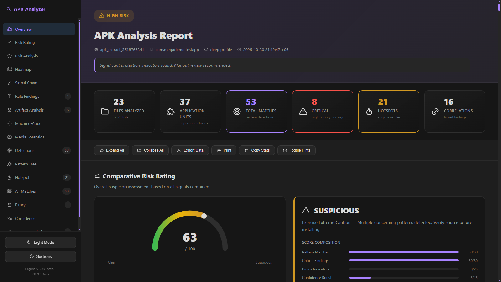

### Finding triage / Разбор находок

Searchable matches with category, file, line, context and review controls.

Поиск по совпадениям, категории, файлы, строки, контекст и элементы ручного разбора.

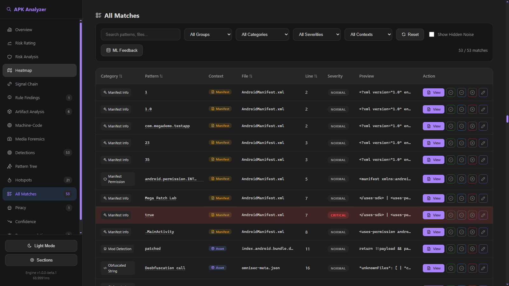

### Heatmap and signal chain / Карта файлов и цепочка сигналов

File-level distribution of matches and the sequence from scanning to the reported verdict.

Распределение совпадений по файлам и этапы формирования итоговой оценки.

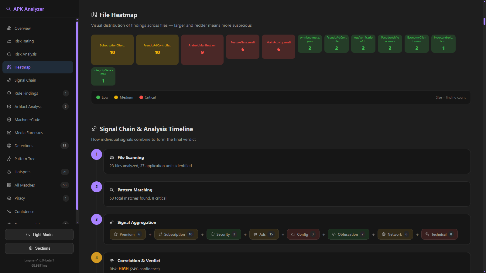

## Web UI

All **10 distinct tool sections** are shown below, plus the completed scan and persistent file browser. `/full`, `/js` and `/js-patch` open the same static-analysis workspace. Tool configuration screens show the actual idle state; they do not imply that each tool was run.

Ниже показаны все **10 самостоятельных разделов инструментов**, а также завершённое сканирование и файловый браузер. `/full`, `/js` и `/js-patch` открывают общую среду статического анализа. Экраны настройки показывают реальное состояние до запуска и не означают, что каждый инструмент был запущен.

The binary reports `v1.0.0-beta.1`; the current Web UI footer still contains the older static label `v1.0.0-beta.10 · Bundle fix 2`. These captures preserve what the compiled application displays.

Бинарник сообщает `v1.0.0-beta.1`, а в текущем подвале Web UI осталась статическая подпись `v1.0.0-beta.10 · Bundle fix 2`. На снимках сохранено фактическое отображение собранного приложения.

### Static analysis / Статический анализ

The starting screen: target file, supported formats, analysis profile and optional modules.

Стартовый экран: целевой файл, форматы, профиль анализа и дополнительные модули.

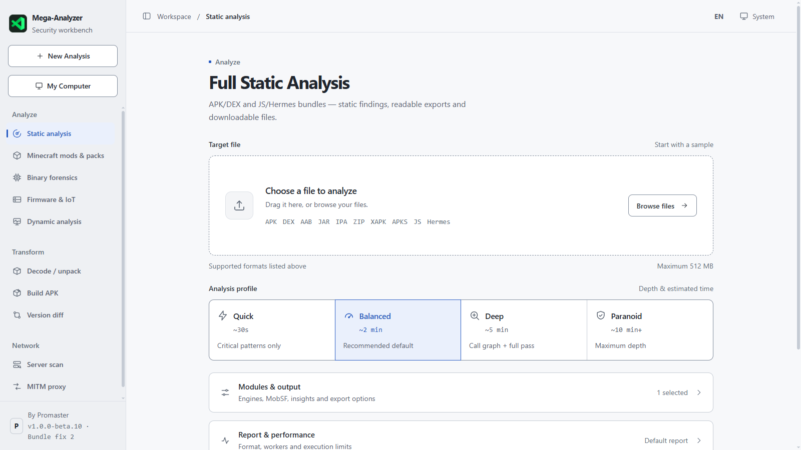

### Completed scan / Завершённое сканирование

An actual browser upload of the same APK, using the Balanced profile: completed log, normalized results and report downloads.

Реальная загрузка того же APK через браузер с профилем Balanced: завершённый журнал, нормализованные результаты и скачивание отчёта.

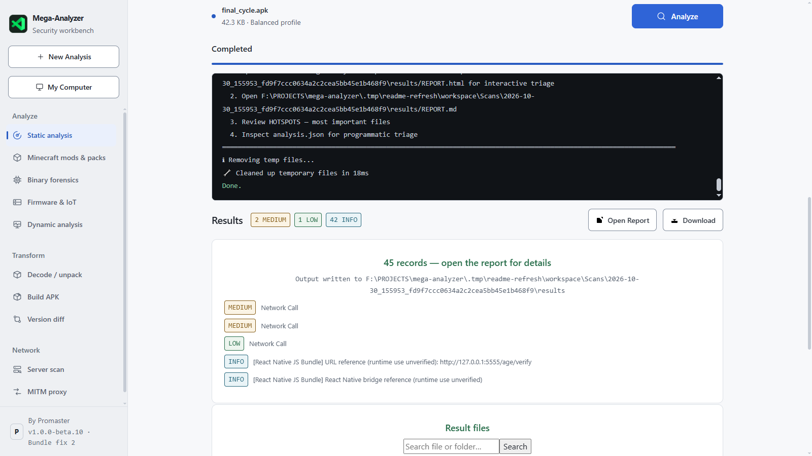

### My Computer / Мой компьютер

Persistent scan files with a Markdown report preview.

Сохранённые файлы сканирования и предпросмотр Markdown-отчёта.

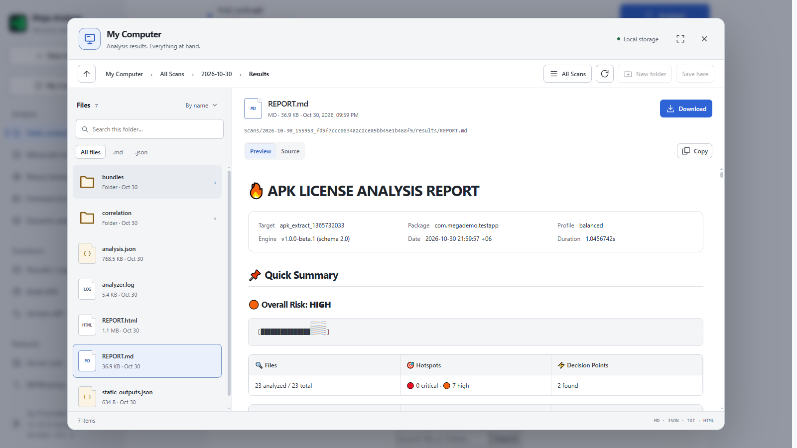

### Minecraft mods and packs / Minecraft-моды и паки

The package-analysis screen for Java mods, texture packs and Bedrock add-ons.

Экран анализа Java-модов, текстурных паков и дополнений Bedrock.

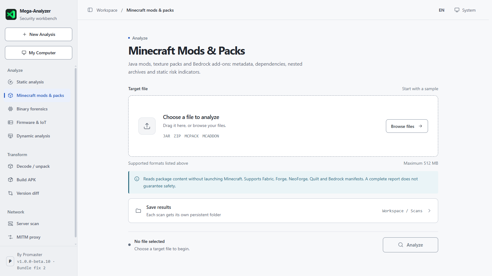

### Binary forensics / Анализ бинарников

The machine-code analysis screen; the deeper OmniSec path requires the optional native build.

Экран анализа машинного кода; углублённый путь OmniSec требует отдельной нативной сборки.

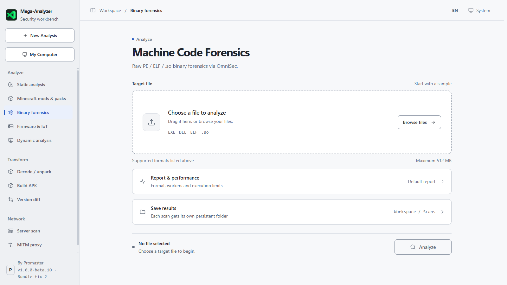

### Firmware and IoT / Прошивки и IoT

The target and report settings for firmware images, root filesystems and archives.

Выбор прошивки, файловой системы или архива и настройки отчёта.

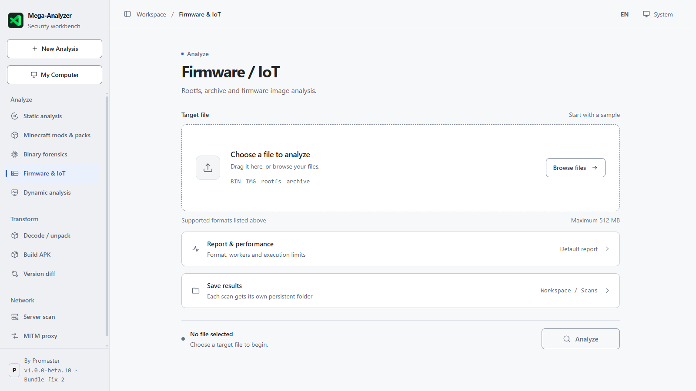

### Dynamic analysis / Динамический анализ

The preparation screen, environment selector and activity tabs. No sample was executed for this screenshot; the current host is marked not runnable.

Экран подготовки, выбор окружения и вкладки активности. Образец для этого снимка не запускался; текущий хост отмечен как недоступный для выполнения.

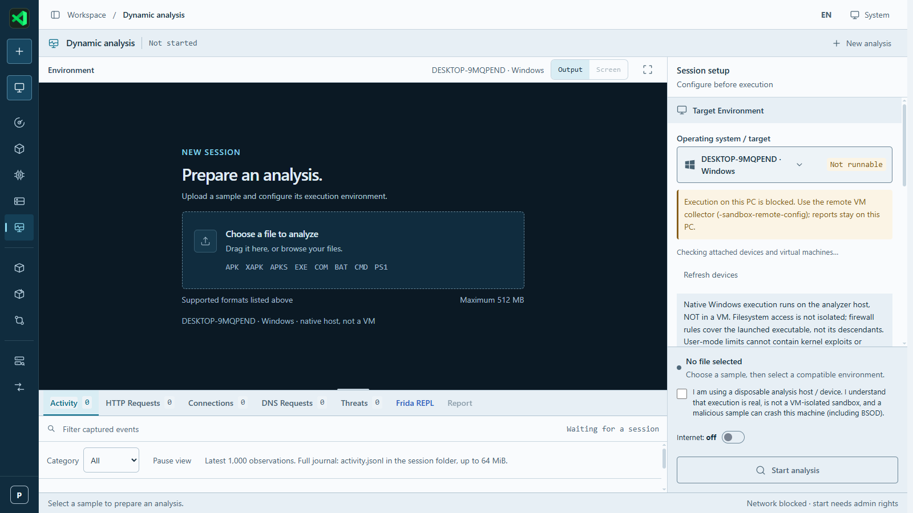

### Decode and unpack / Декодирование и распаковка

APK/DEX decoding options, including Java pseudocode and original APK metadata.

Параметры декодирования APK/DEX, включая Java-псевдокод и оригинальные метаданные APK.

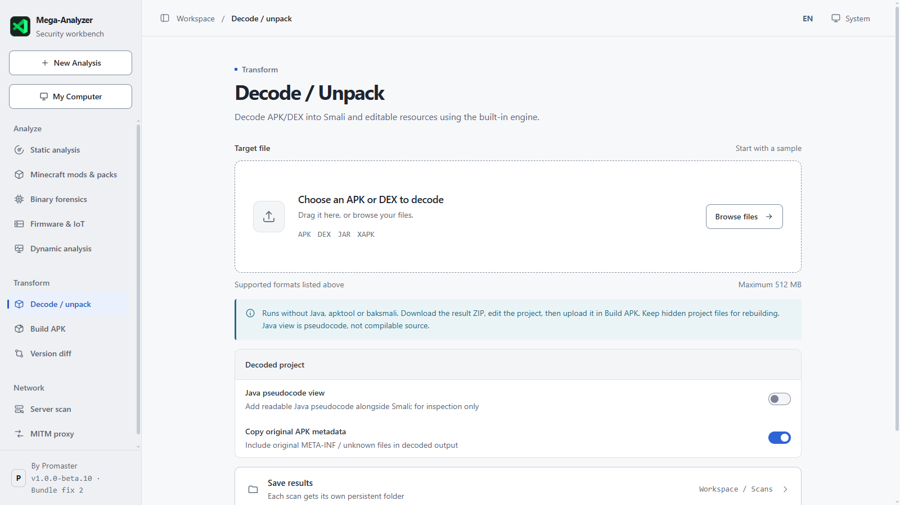

### Build APK / Сборка APK

Build from a decoded project ZIP, choose compression and configure signing.

Сборка из ZIP с декодированным проектом, выбор сжатия и настройки подписи.

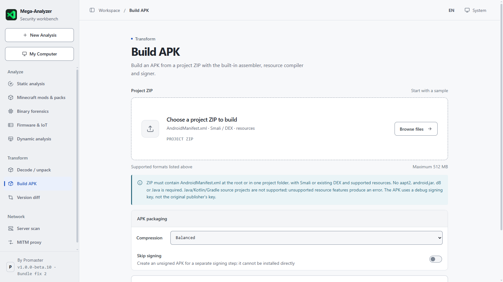

### Version diff / Сравнение версий

Separate inputs for the original file and the new build.

Отдельные поля для исходного файла и новой сборки.

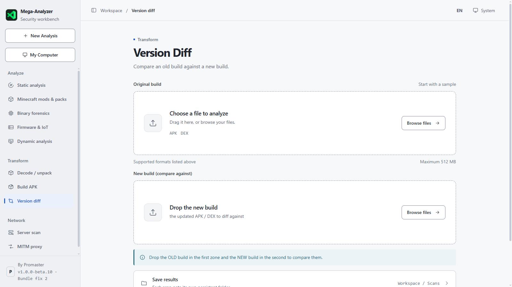

### Server scan / Сканирование сервера

Target URL and authorization controls for an active scan. No network scan was started.

URL цели и подтверждение прав для активного сканирования. Сетевое сканирование не запускалось.

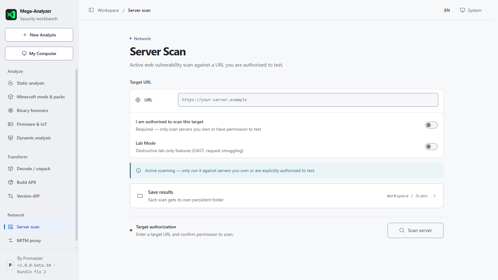

### MITM proxy / MITM-прокси

Local listening port and upstream server configuration. No proxy session was started.

Локальный порт и адрес сервера для перенаправления. Сессия прокси не запускалась.

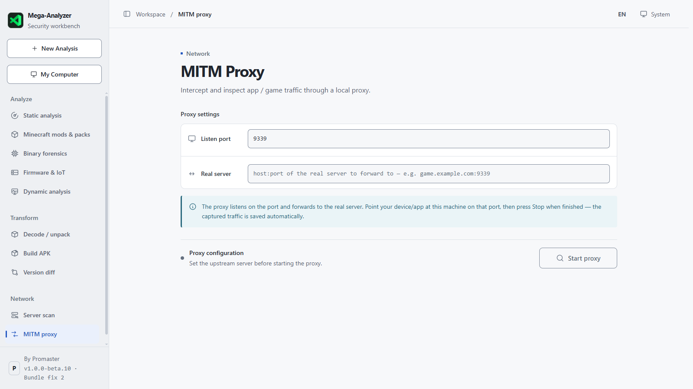

## Capture details

| Setting / Параметр | Value / Значение |
| :--- | :--- |
| Build / Сборка | Go core, Windows amd64, Go 1.27.3 |
| Viewport / Размер | 1600 × 900, device scale factor 1 |
| HTML report / HTML-отчёт | Deep profile, `-report all -sarif -no-profile` |
| Browser scan / Сканирование в браузере | Balanced profile, default Web UI modules |
| Appearance / Оформление | Report: dark / отчёт: тёмный; Web UI: light / светлый |
| APK SHA-256 | `69d818016ba7fa4267a8e08f0b9ad4d395d5ce344ec74a278d988ad9e7de77ee` |

Commands used in Windows PowerShell / Команды в Windows PowerShell:

```powershell
go build -trimpath -ldflags "-s -w" -o .tmp/readme-refresh/analyzer.exe ./pkg/cmd/analyzer

.\.tmp\readme-refresh\analyzer.exe -t demo/demo_test_apk/final_cycle.apk `
  -o .tmp/readme-refresh/apk-report -profile deep -report all -sarif `
  -no-profile -no-tui -no-color

# Open .tmp/readme-refresh/apk-report/REPORT.html in a browser.
# Открой .tmp/readme-refresh/apk-report/REPORT.html в браузере.

$env:MEGA_ANALYZER_WORKSPACE = "$PWD/.tmp/readme-refresh/workspace"
.\.tmp\readme-refresh\analyzer.exe --web --web-port 7484 --no-profile --no-tui --no-color
```

The APK used here is a local build artifact, not a file guaranteed to be present in a fresh checkout. See the [fixture build notes](../demo/demo_test_apk/README.md). For the readily available source-only demo, substitute `demo/vulnerable-app` as the target; the resulting counts will differ.

Использованный APK — локальный артефакт сборки; в свежем клоне его может не быть. См. [инструкции к фикстуре](../demo/demo_test_apk/README.md). Для готового примера из исходников укажи цель `demo/vulnerable-app`; счётчики результата будут другими.

The CLI and browser captures use different profiles and output views. Raw matches, normalized findings and rule findings are separate counters and should not be compared as the same metric.

Снимки CLI-отчёта и браузерного запуска используют разные профили и представления результатов. Совпадения паттернов, нормализованные находки и находки правил — отдельные счётчики, их нельзя сравнивать как одну метрику.
